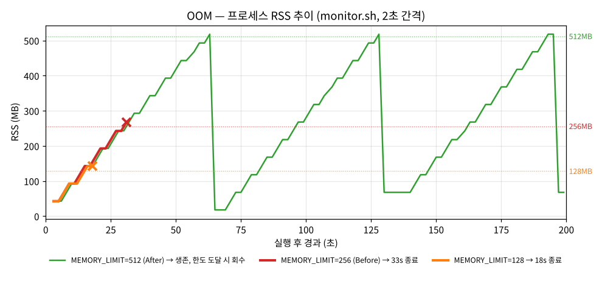
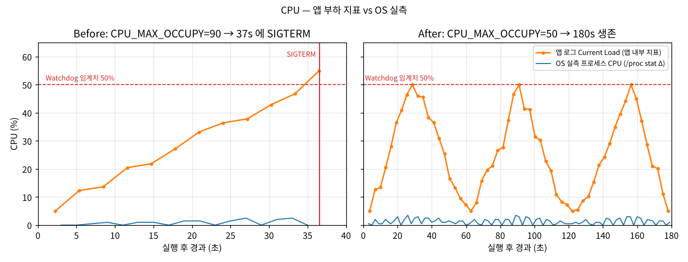
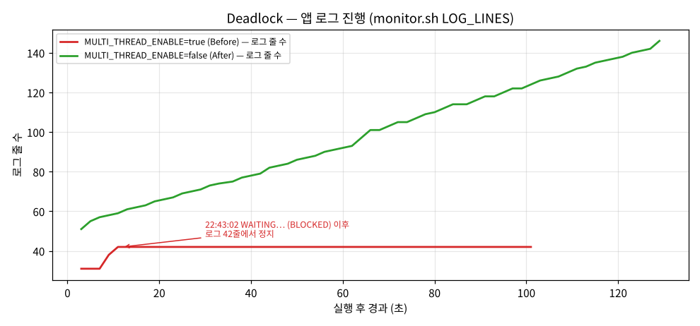
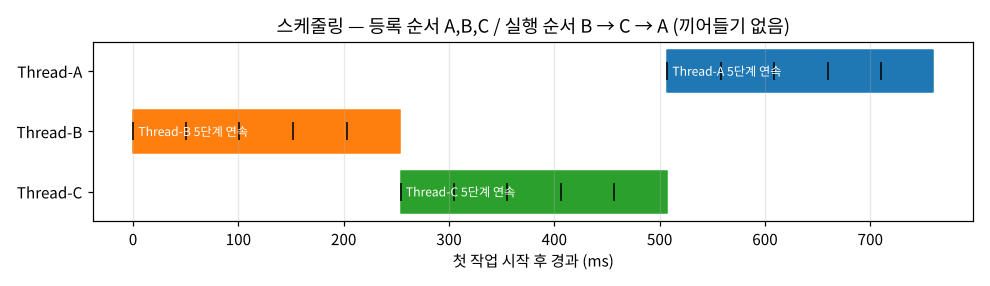

# linux-incident-analysis

> Root cause analysis of OOM, CPU spike and deadlock on Linux — reproducible runs, `/proc`-based monitoring and GitHub Issue–style reports
> 리눅스 장애(OOM · CPU 과점유 · 데드락)를 관제 데이터로 재현·진단하고 GitHub Issue 형식으로 보고한 원인 분석 프로젝트


장애가 있는 바이너리 `agent-leak-app` 을 **변수 하나만 바꿔 가며 반복 실행**하고, 2초 간격 프로세스 관제 · 앱 로그 · `ps`/`top`/`strace` 출력을 원본 그대로 남겨, **"현상 → 증거 → 원인 → 조치"** 구조의 리포트 3건 + 보너스 분석 1건을 작성했습니다.

| # | 리포트 | 한 줄 결론 | Before → After | Issue |
| --- | --- | --- | --- | --- |
| 1 | [**[Bug] OOM** — MemoryGuard 자체 종료](issues/01-oom-memory-guard.md) | Heap 이 3초마다 +25MB 누수 → 한도 도달 시 앱이 `kill(자기 PID, SIGKILL)` | `MEMORY_LIMIT` 256 → 512 : **33s 종료 → 300s 생존** | [#1](https://github.com/maebsy/linux-incident-analysis/issues/1) |
| 2 | [**[Bug] CPU** — Watchdog SIGTERM](issues/02-cpu-watchdog.md) | 부하 상한(`CPU_MAX_OCCUPY`)이 고정 임계치 50% 보다 높아 반드시 초과 → SIGTERM | `CPU_MAX_OCCUPY` 90 → 50 : **25~37s 종료 → 180s 생존** | [#2](https://github.com/maebsy/linux-incident-analysis/issues/2) |
| 3 | [**[Bug] Deadlock** — 무응답](issues/03-deadlock.md) | 두 워커가 A→B / B→A 반대 순서로 락 획득 → 순환 대기, PID 는 살아 있음 | `MULTI_THREAD_ENABLE` true → false : **9초 후 정지 → 120s 정상 진행** | [#3](https://github.com/maebsy/linux-incident-analysis/issues/3) |
| ★ | [**[Analysis] 스케줄링 추론**](issues/04-scheduling-analysis.md) **(보너스)** | 선점 없음 + 등록 순서(A,B,C)와 다른 고정 순서 B→C→A 가 8/8 반복 | **비선점 Priority** 로 추론 | [#4](https://github.com/maebsy/linux-incident-analysis/issues/4) |

> 📌 같은 내용을 GitHub Issues [#1](https://github.com/maebsy/linux-incident-analysis/issues/1) · [#2](https://github.com/maebsy/linux-incident-analysis/issues/2) · [#3](https://github.com/maebsy/linux-incident-analysis/issues/3) · [#4](https://github.com/maebsy/linux-incident-analysis/issues/4) 로 등록했습니다 (`tools/publish-issues.sh`).

## 목차

- [핵심 발견](#핵심-발견)
- [빠른 시작](#빠른-시작)
- [도구](#도구)
- [증거 자료](#증거-자료)
- [요구사항 구현 매핑](#요구사항-구현-매핑)
- [선택(보너스) 과제 구현 내역](#선택보너스-과제-구현-내역)
- [직접 수행해야 하는 부분](#직접-수행해야-하는-부분)
- [프로젝트 구조](#프로젝트-구조)
- [테스트](#테스트)
- [문서](#문서)

## 핵심 발견

<table>
<tr>
<td width="50%"><br><sub><b>OOM</b> — 세 실행 모두 같은 기울기로 증가. 한도만이 죽는 시점을 결정</sub></td>
<td width="50%"><br><sub><b>CPU</b> — 앱 지표는 50% 를 넘는 순간 종료, OS 실측은 0~3.5%</sub></td>
</tr>
<tr>
<td><br><sub><b>Deadlock</b> — 로그 42줄에서 정지, PID·스레드는 그대로</sub></td>
<td><br><sub><b>보너스</b> — B → C → A 순으로 끼어들기 없이 실행</sub></td>
</tr>
</table>

1. **세 장애 모두 "앱의 보호 정책" 이 종료(또는 멈춤)의 직접 주체였다.** `strace -f` 로 OOM 은 `kill(4676, SIGKILL)`, CPU 는 `kill(12953, SIGTERM)` — 호출자와 대상이 같은 PID 임을 확인했습니다. 커널 OOM Killer 나 외부 kill 이 아닙니다. ([방법론 4장](docs/methodology.md#4-종료-원인-판별-앱이-죽였나-커널이-죽였나))
2. **CPU Watchdog 의 기준은 `CPU_MAX_OCCUPY` 가 아니라 고정 50%.** 60 으로 낮춰도 51.07% 에서 죽고, 50 이면 정확히 50.00% 에 닿고 쿨다운합니다(초과가 아니므로 생존). 경계 실험 `cpu-60` 하나로 드러난 사실입니다.
3. **앱이 보고하는 CPU 부하와 OS 실측은 다르다.** 앱 로그 `Current Load` 는 54.96% 까지 올랐지만 `/proc` 실측은 최대 2.5%, 25초 동안 총 CPU 시간 0.28초. 리포트에 두 값을 나란히 적고, "급상승 구간" 은 앱 지표로 식별했다고 명시했습니다.
4. **Deadlock 은 "CPU 0%" 하나로 판정하지 않았다.** 10초 구간 CPU tick Δ0 + RSS 고정 + 로그 정지 + 전 스레드 `futex_do_wait` + 로그상 순환 대기, 다섯 가지가 모두 성립할 때만 DEADLOCK 으로 판정합니다(`diagnose-hang.sh`). 정상 실행은 스레드가 똑같이 `S` 로 보여도 구간 변화가 있어 "진행 중" 으로 나옵니다. 동료 평가 후에는 **스레드별 스택 덤프**로 두 워커가 각자의 함수(`os_pbl.py` 693 · 712줄)에서 두 번째 락을 기다리며 멈춘 것까지 확인했고, 재현율은 10/10(동시성 off 는 0/10)입니다([Deadlock 2-5](issues/03-deadlock.md#2-5-스레드별-스택-덤프--코드-레벨에서-a--b--a-확인)).

## 빠른 시작

**준비** — B4-1 과 같은 환경(`agent-admin` 계정, `/home/agent-admin/agent-app`, `api_keys/secret.key`, `/var/log/agent-app`)에 `agent-leak-app-x86` 을 둡니다. 경로는 [`tools/env/base.env`](tools/env/base.env) 에서 바꿀 수 있습니다.

```bash
git clone https://github.com/maebsy/linux-incident-analysis.git
cd linux-incident-analysis
sudo -iu agent-admin bash -c "cd $PWD && tools/run-scenario.sh scenarios/oom-before.env"
```

```text
scenario      : oom-before
env           : MEMORY_LIMIT=256 CPU_MAX_OCCUPY=50 MULTI_THREAD_ENABLE=false
survival      : 33s
exit_code     : 137 (128 + SIGKILL)
peak_rss      : 267.6MB
last_app_log  : 2026-10-12 22:31:35,852 [CRITICAL] [MemoryGuard] Self-terminating process 3848 to prevent system instability.
```

```bash
tools/run-scenario.sh scenarios/cpu-before.env --trace        # + strace 로 신호 출처 기록
tools/run-scenario.sh scenarios/deadlock-before.env --max 90  # 90초 뒤 자동 진단 → DEADLOCK 판정
tools/run-all.sh                                              # 리포트의 모든 실행 재현 (약 20분)
```

앱은 root 로 실행하면 Boot [1/6] 에서 거부하므로 스크립트도 root 실행을 막습니다.

**재현 컨테이너 (VM 없이)** — 제공 바이너리를 [`bin/`](bin/) 에 넣어 두었고(sha256: [`bin/SHA256SUMS`](bin/SHA256SUMS), 원래 실험의 `7e0a19cf…bb3e40` 과 같음), [`repro/Dockerfile`](repro/Dockerfile) 이 Boot 6단계 조건(계정 · 환경변수 · secret.key · 포트 · 로그 권한)을 갖춘 Ubuntu 24.04 를 만듭니다. [`repro/run.sh`](repro/run.sh) 는 원래 VM 과 같게 2 vCPU · 8GB · swap 없음으로 실행하고 저장소를 마운트하므로 결과가 `evidence/` 에 그대로 남습니다.

```bash
repro/run.sh tools/run-scenario.sh scenarios/oom-before.env          # 33~34초, exit 137 (원래 VM 결과와 같음)
repro/run.sh tools/sweep.sh scenarios/cpu-before.env CPU_MAX_OCCUPY 50 51 60 90 --repeat 3 --max 120
```

## 도구

모든 분석 도구는 **Bash + 리눅스 표준 명령어**(`/proc`, `ps`, `top`, `pstree`, `strace`, `awk`)만 씁니다. 바이너리를 디컴파일하거나 내부를 들여다보지 않고, **실행하고 OS 에서 관찰한 것만** 근거로 삼았습니다.

| 도구 | 역할 | 핵심 |
| --- | --- | --- |
| [`tools/monitor.sh`](tools/monitor.sh) | 프로세스 단위 관제 (B4-1 monitor.sh 확장) | PyInstaller 부모/자식 중 **실제 앱(자식)** 을 골라 `/proc` 에서 구간 CPU · VmRSS · 스레드 수 · 로그 줄 수를 2초마다 고정 포맷으로 기록. 종료 시 `STATE:GONE`. `--header` 실험 ID 머리줄, `--csv` 추세 분석용 CSV |
| [`tools/run-scenario.sh`](tools/run-scenario.sh) | 시나리오 1회 실행 | 앱 실행 + 관제 + `ps`/`pstree` + `top -b` + (선택) `strace -f` + (살아 있으면) 무응답 진단 → `result.txt` 에 실험 ID · 생존 시간 · 종료 코드 · 신호 이름 · 앱 PID · 종료 직전 부하/힙 N개 · 최대 RSS 요약. 모든 산출물 첫 줄에 같은 실험 ID |
| [`tools/diagnose-hang.sh`](tools/diagnose-hang.sh) | "살아 있지만 멈춘" 프로세스 진단 | ps -ef → ps -L wchan → top -H → `/proc/task/*` 10초 비교 → 로그 마지막 줄 → 락 보유/대기 추출 → **wait-for 그래프 순환 탐지** → **스레드별 스택 덤프**(py-spy → gdb → `/proc/<tid>/stack`) → **DEADLOCK / HANG / 진행 중** 판정 |
| [`tools/sweep.sh`](tools/sweep.sh) | 변수 하나를 여러 값으로 반복 실행 | 값마다 env 를 만들어 N회 실행 → 값별 종료/생존 · 생존 시간 · 종료 코드 · DEADLOCK 판정 수 · 종료 직전 부하 요약표 (안정/경계 케이스, 재현율) |
| [`tools/latency-probe.sh`](tools/latency-probe.sh) | 다른 프로세스가 느려지는지 | 0.5초마다 로컬 HTTP 왕복 시간과 `sleep 0.1` 스케줄링 지연 → p50 / p95 / max |
| [`repro/`](repro/) | 실제 바이너리 재현 컨테이너 | `bin/agent-leak-app-x86` + Boot 조건 + py-spy · gdb, 2 vCPU · 8GB · swap 없음 |
| [`tools/compare.sh`](tools/compare.sh) | Before/After 표 | 여러 `result.txt` → 마크다운 비교표 ([`evidence/summary.md`](evidence/summary.md)) |
| [`tools/analyze-schedule.sh`](tools/analyze-schedule.sh) | **(보너스)** 스케줄링 역추론 | ms 타임라인 · 전환 횟수 · 연속 실행 여부 · 실행 간 순서 고정 여부 → RR / FCFS / Priority 판정 |
| [`tools/plot-evidence.py`](tools/plot-evidence.py) | 리포트용 그래프 (보조) | evidence 원본을 가공 없이 시각화 → `docs/images/*.png` (판정에는 쓰지 않음) |
| [`tools/publish-issues.sh`](tools/publish-issues.sh) | 리포트 → GitHub Issue 등록 | front matter 의 제목·라벨 사용, 상대 링크를 blob URL 로 변환, 중복 제목은 건너뜀 (REST API) |
| [`scenarios/*.env`](scenarios/) | 실험 조건 | 각 Before/After 는 **환경변수 하나만** 다름. 경계 실험 `oom-128`, `cpu-60` 포함 |

`monitor.sh` 출력 예 (첫 줄은 `--header`, 2026-11 후속 실험부터):

```text
# monitor.sh experiment=oom-before-20261110-105000 start=2026-11-10 10:50:00 interval=1s clk_tck=100 pid=44 pattern=agent-leak-app
[2026-10-12 22:31:16] PROCESS:agent-leak-app PID:3848 STATE:S CPU:0.5% MEM:1.5% RSS:117.6MB THREADS:1 SYS_CPU:1.2% SYS_MEM:7.0% LOG_LINES:36
```

실행 샘플 원본: [2초 주기 · 33초 (OOM Before)](evidence/oom-before/20261012-223103/monitor.log) · [1초 주기 + CSV](evidence/followup/oom-before/) · [1초 주기 600초 장기 시계열 + CSV](evidence/followup/oom-after/) · [Deadlock 300초 + 스택 덤프](evidence/followup/deadlock-before/). 샘플 주기별 측정 오차(1초 ±1%p, 2초 ±0.5%p)와 권장값은 [방법론 2-2](docs/methodology.md#2-2-샘플-주기와-측정-오차).

필드 출처와 선택 이유, CPU 측정 도구(`ps` 누적 평균 vs `top` vs `/proc` 구간 차이) 비교는 [docs/methodology.md](docs/methodology.md).

## 증거 자료

[`evidence/`](evidence/) 에 **17회 실행**의 원본(앱 로그, 관제 로그, ps/pstree, top, strace, 진단, 요약)을 그대로 보관했습니다. 리포트의 모든 수치와 로그 발췌는 여기서 인용했고 각 리포트에 원본 파일 링크가 있습니다. 실행 목록과 파일 설명: [evidence/README.md](evidence/README.md)

| 시나리오 | 실행 | 결과 |
| --- | --- | --- |
| OOM | Before 3회 (+trace, +top) · 128MB 경계 1회 · After 1회 | 33·33·34s / 18s / 300s 생존 |
| CPU | Before 3회 (+trace, +top) · 60% 경계 1회 · After 1회 | 37·25·31s / 24s / 180s 생존 |
| Deadlock | Before 1회 · After 1회 | DEADLOCK 판정 / 진행 중 |
| 보너스 | 정상 실행 5회 (+ After 3회 재사용) | 8/8 B → C → A |

**동료 평가 후속 실측 46회** ([`evidence/followup/`](evidence/followup/)) — 같은 바이너리를 재현 컨테이너에서 실행했습니다.

| 실험 | 실행 | 결과 | 리포트 |
| --- | --- | --- | --- |
| Deadlock 300초 관찰 + 스택 덤프 | 1 (+ 스택 전용 2) | 300초 동안 자가 복구 없음, 693·712줄에서 락 대기 | [Deadlock 2-5, 4장](issues/03-deadlock.md#2-5-스레드별-스택-덤프--코드-레벨에서-a--b--a-확인) |
| Deadlock 재현율 | true 10 · false 10 | **10/10 · 0/10** | [Deadlock 4장](issues/03-deadlock.md#재현율-동시성-모드에서-몇-번-중-몇-번-나나) |
| CPU 안정/경계 자동 반복 | 50 · 51 · 55 · 60 · 70 · 90 × 3 | 50 만 생존(3/3), 51~90 은 15/15 종료 | [CPU 4장](issues/02-cpu-watchdog.md#자동-반복-실행--안정-케이스와-경계-케이스) |
| 다른 프로세스 지연 | 1 + 기준·대조군 | 앱 실행 중에도 지연 변화 없음 (대조군은 p95 10배) | [CPU 4장](issues/02-cpu-watchdog.md#다른-프로세스에-미치는-영향-latency) |
| OOM 1초 주기 · 600초 장기 시계열 (CSV) | 2 | 8.05 MB/s, 정리 9회 · 65~66초 간격 | [OOM 2-1, 4장](issues/01-oom-memory-guard.md) |
| MemoryGuard 분기 경계 | 257 · 300 · 400 · 511 | 모두 정리 후 생존 → 경계 256/257 | [OOM 3장](issues/01-oom-memory-guard.md#3-root-cause-analysis-원인-분석) |

## 요구사항 구현 매핑

| 미션 요구사항 | 구현 · 근거 |
| --- | --- |
| 3가지 장애 각각 GitHub Issue 형태 리포트 | [issues/01](issues/01-oom-memory-guard.md) · [02](issues/02-cpu-watchdog.md) · [03](issues/03-deadlock.md), [Issue 템플릿](.github/ISSUE_TEMPLATE/bug_report.md), 실제 GitHub Issues 등록 |
| 필수 항목: 발생 현상 / 재현 경로·증거 / 근본 원인 / 조치 / Before & After | 각 리포트 1~4장 + "재현 방법" |
| [OOM] monitor.sh 메모리 상승 수치 | OOM 2-1 (RSS 42.6 → 267.6MB, ≈8MB/s) + 그래프 |
| [OOM] 종료 직전·직후 로그 | OOM 2-3 (`Memory limit exceeded` → `Self-terminating process 3848`) |
| [OOM] MEMORY_LIMIT 전후 비교, 최소 2회 | Before 3회 + 경계 1회 + After 1회 (OOM 2-5, 4장) |
| [CPU] CPU 급상승 구간 (top/ps/관제) | CPU 2-1~2-3 (앱 지표 5 → 54.96%, `top -b`, monitor.log, 두 지표 비교 그래프) |
| [CPU] 종료 로그 + Watchdog 정책에 의한 보호 조치 입증 | CPU 2-1 `CPU Threshold Violated!` + 2-4 exit 143 + 2-5 strace `kill(자기 PID, SIGTERM)` |
| [CPU] CPU_MAX_OCCUPY 전후 비교 | 90 ×3 / 60 / 50 (CPU 2-2, 4장) |
| [Deadlock] PID 존재 (`ps -ef`) | Deadlock 2-1 (PID 17379 → 17428, pstree 스레드 2개) |
| [Deadlock] CPU/MEM 정체 (`top -H`, `ps -L`) | Deadlock 2-2 (전 스레드 S + futex, 10초 Δ0) |
| [Deadlock] 마지막 로그 `WAITING … BLOCKED` | Deadlock 2-4 |
| [Deadlock] 스레드/락 대기 추론 근거 | Deadlock 3-1 (대기 그래프), 3-2 (4조건) |
| [Deadlock] MULTI_THREAD_ENABLE 재현/회피 비교 | Deadlock 4장 |
| 리눅스 표준 명령어 사용, 디컴파일 금지 | Bash · `/proc` · ps · top · pstree · strace 만 사용 (strace 는 OS 에 요청한 시스템 콜만 관찰) |
| 체크리스트 (항목 1~4) | [docs/checklist.md](docs/checklist.md) |

## 선택(보너스) 과제 구현 내역

> 미션의 **"5. 보너스 과제 (선택)"** 에 해당하는 부분입니다. 아래 외의 내용은 모두 필수 과제입니다.

| 보너스 요구 | 구현 | 위치 |
| --- | --- | --- |
| 로그 타임스탬프로 실행 순서·교체 주기 패턴화 | ms 단위 타임라인, 단계 간격(≈50.7ms), 전환 횟수(2회), 작업별 연속 실행 구간(203ms) 자동 계산 | [`tools/analyze-schedule.sh`](tools/analyze-schedule.sh), [`evidence/schedule-runs/analysis.txt`](evidence/schedule-runs/analysis.txt) |
| RR / FCFS / Priority 중 추론 | 후보별 "기대 로그 vs 실제" 비교 → RR 배제(선점 없음) → FCFS 배제(등록 순서와 다름) → **비선점 Priority (B > C > A)**, 한계 명시 | [issues/04 3장](issues/04-scheduling-analysis.md#3-패턴-분석-및-결론) |
| 장단점 · 적합한 아키텍처 | 장단점 표(기아·호위 효과·우선순위 역전), 배치/알림 서버 적합 vs 실시간 웹·대화형 부적합 | [issues/04 4장](issues/04-scheduling-analysis.md#4-장단점-및-적합한-아키텍처) |
| (추가) 판정 로직 테스트 | Priority·FCFS·RR 각각의 가상 로그로 판정 검증 | [`tests/fixtures/schedule-*.log`](tests/fixtures/) |

필수 범위를 넘어 추가로 만든 것(보너스 과제는 아님): 경계 실험(`oom-128`, `cpu-60`), `strace` 신호 출처 판별, 앱 지표 vs OS 실측 비교, 그래프, 자동 테스트와 CI.

## 직접 수행해야 하는 부분

리포트의 증거는 이 저장소 작성 시 **격리된 Ubuntu 24.04 환경에서 실제 바이너리로 실행한 결과**입니다. 제출 환경에 맞춰 아래는 직접 하시면 됩니다.

| 할 일 | 방법 | 비고 |
| --- | --- | --- |
| (선택) 본인 VM 에서 재현 | `sudo -iu agent-admin bash -c 'cd <repo> && tools/run-all.sh'` · VM 이 없으면 `repro/run.sh tools/run-all.sh` | 결과는 `evidence/<시나리오>/<새 시각>/` 에 추가됨. 생존 시간은 ±수 초 다를 수 있음 |
| (선택) 터미널 스크린샷 | 위 실행 중 `ps -ef \| grep agent`, `top -H -p <PID>` 화면 캡처 → `docs/images/` | 미션은 "스크린샷 **또는** 로그 발췌" 라 현재 로그 발췌로 요건 충족 |
| 저장소 공개 설정 | 제출이 링크 방식이면 Settings → General → Danger Zone → **Change visibility → Public** | 현재 Private |
| GitHub Issues 확인 | [Issues 탭](https://github.com/maebsy/linux-incident-analysis/issues)에 #1~#4 가 보이는지 확인 | 이미 등록됨. 다시 만들 땐 `tools/publish-issues.sh` |

## 프로젝트 구조

```
linux-incident-analysis/
├── bin/                          # 제공 바이너리 (x86 · arm64) + SHA256SUMS
├── repro/                        # 실제 바이너리 재현 컨테이너 (Dockerfile · run.sh)
├── issues/                       # 리포트 (GitHub Issue 본문과 동일)
│   ├── 01-oom-memory-guard.md
│   ├── 02-cpu-watchdog.md
│   ├── 03-deadlock.md
│   └── 04-scheduling-analysis.md   # [보너스]
├── tools/
│   ├── monitor.sh                # 프로세스 관제
│   ├── run-scenario.sh           # 시나리오 1회 실행 + 증거 수집
│   ├── diagnose-hang.sh          # 무응답 진단 (Deadlock 판정)
│   ├── compare.sh                # Before/After 표
│   ├── sweep.sh                  # 변수 하나 반복 실행 + 요약 (안정/경계, 재현율)
│   ├── latency-probe.sh          # 다른 프로세스 지연 측정
│   ├── analyze-schedule.sh       # [보너스] 스케줄링 역추론
│   ├── run-all.sh                # 전체 재현
│   ├── plot-evidence.py          # 그래프 (보조)
│   ├── publish-issues.sh         # issues/*.md → GitHub Issues
│   └── env/base.env              # 공통 환경 (AGENT_HOME, 포트, 키 경로 …)
├── scenarios/                    # 실험 조건 (*.env, 변수 하나씩만 다름)
├── evidence/                     # 실행 원본 (17회) + summary.md, followup/ (동료 평가 후속 46회)
├── docs/
│   ├── methodology.md            # 분석 방법론
│   ├── checklist.md              # 체크리스트 답변
│   ├── runbook.md                # 치명도·SLA, 동시 장애 우선순위, 알림, 회고 체크리스트
│   ├── feedback.md               # 동료 평가 반영 체크리스트
│   ├── images/                   # 그래프
│   └── presentation.html         # 동료 평가 발표 슬라이드
├── tests/                        # 가짜 앱 + fixtures 로 도구 검증
└── .github/                      # Issue · PR 템플릿, CI
```

## 테스트

실제 바이너리·root 없이 도구를 검증합니다. [`tests/fake-agent-leak-app.py`](tests/fake-agent-leak-app.py) 가 **실제 메모리 증가 · 실제 교착 상태(락 2개 반대 순서) · 실제 CPU 사용**을 만들고, 스케줄링 판정은 fixture 로그로 검증합니다. 같은 가짜 앱에 리포트의 개선안(상한 있는 버퍼, 락 순서 고정, 타임아웃 + 재시도)을 적용한 모드도 있어 [`tests/run-fix-tests.sh`](tests/run-fix-tests.sh) 가 그 효과를 검증합니다(`run-tests.sh` 끝에서 함께 실행).

```bash
bash tests/run-tests.sh
```

```text
[monitor.sh: 메모리 증가 추적]
  PASS RSS 증가 감지 (64.3 → 130.0 MB)
  PASS --header: 실험 ID·시작 시각·주기·PID 머리줄
  PASS --csv: 열 이름과 값 형식
[monitor.sh: 구간 CPU 실측 (ps %cpu 누적 평균과 다름)]
  PASS 바쁜 프로세스 CPU ≥ 70% (측정 100.0%)
[diagnose-hang.sh: 실제 교착 상태 판정]
  PASS 결론 DEADLOCK
  PASS wait-for 그래프 순환 탐지
  PASS 스레드별 스택 덤프 단계 (도구가 없으면 /proc wchan 까지)
  PASS 바쁜 프로세스는 '진행 중'
[analyze-schedule.sh: 알고리즘 판정 (보너스)]
  PASS B→C→A 고정 + 비선점 → Priority
  PASS 등록 순서대로 연속 실행 → FCFS
  PASS 중간 교대 → Round-Robin
결과: 39 passed, 0 failed

[개선안 참고 구현 테스트]                      # tests/run-fix-tests.sh — 리포트의 코드 레벨 제안을 가짜 앱에 적용
[leak-bounded: 8초 RSS 관찰]
  PASS 마지막 RSS 50~100MB, 후반 4개 표본 변동 ≤15MB
[deadlock-ordered: 진행 및 진단]
  PASS 진단: 진행 중
[deadlock-timeout: 진행 및 진단]
  PASS TIMEOUT 후 retry 기록
  PASS 진단: 진행 중
결과: PASS 17, FAIL 0
```

GitHub Actions 가 push 마다 ShellCheck(경고 0) + 테스트를 실행합니다: [`.github/workflows/tests.yml`](.github/workflows/tests.yml)

### Docker 로 실행 (CI 와 같은 Ubuntu 24.04)

도구 테스트를 CI 와 같은 OS 에서 돌립니다. 컨테이너는 자기 PID 네임스페이스를 가져서, 프로세스가 많은 데스크톱에서도 `/proc` 관측 조건이 같습니다.

```bash
docker build -t linux-incident-analysis .
docker run --rm --cap-add SYS_PTRACE linux-incident-analysis     # ShellCheck + 도구 테스트 (strace 에 ptrace 권한 필요)
```

실제 장애 재현(`agent-leak-app` 실행, 계정·권한 설정)은 "직접 수행해야 하는 부분" 의 VM 절차를 따릅니다. VS Code **Dev Containers** 나 GitHub Codespaces 로 열면 같은 환경에서 작업할 수 있습니다 (`.devcontainer/`).

## 문서

| 문서 | 내용 |
| --- | --- |
| [docs/methodology.md](docs/methodology.md) | 실험 설계, monitor.sh 필드, CPU 도구 비교, 종료 주체 판별(앱 vs 커널 vs 외부), 무응답 진단 순서, 환경과 한계 |
| [docs/checklist.md](docs/checklist.md) | 미션 체크리스트 항목 1~4 답변 (도구·옵션, 판단 흐름, 원리, 확장 질문) |
| [docs/presentation.html](docs/presentation.html) | 동료 평가 발표 슬라이드 68장 (브라우저로 열기, ← → 넘기기 · N 발표자 노트 · 인쇄하면 PDF) |
| [docs/runbook.md](docs/runbook.md) | 장애 유형별 치명도(Sev)·대응 SLA, 동시 장애 우선순위 매트릭스와 단계별 절차, 알림 임계값·경로, 회고 체크리스트 |
| [docs/feedback.md](docs/feedback.md) | 동료 평가 20개 항목 반영 체크리스트 |
| [evidence/README.md](evidence/README.md) | 실행 목록, 파일별 설명, 읽는 법 |
| [.github/ISSUE_TEMPLATE/](.github/ISSUE_TEMPLATE/) | `[Bug]` 장애 리포트 / `[Analysis]` 분석 리포트 템플릿 (재현율 · 치명도 · 스택 덤프 · 회고 항목 포함) |
| [.github/PULL_REQUEST_TEMPLATE.md](.github/PULL_REQUEST_TEMPLATE.md) | PR 을 열면 자동으로 뜨는 재현·검증 표 + 회고 체크리스트 |

리포트는 [`tools/publish-issues.sh`](tools/publish-issues.sh) 로 GitHub Issue 에 등록했습니다. `issues/*.md` 의 front matter(`title`, `labels`)를 그대로 쓰고, 없는 라벨(`incident`, `memory`, `cpu`, `deadlock`, `analysis`)은 만들고, 저장소 상대 링크는 Issue 화면에서 열리도록 blob URL 로 바꿉니다. 같은 제목이 이미 있으면 건너뜁니다.

```bash
DRY_RUN=1 tools/publish-issues.sh   # 미리 보기
tools/publish-issues.sh             # 등록 (gh auth 필요)
```
