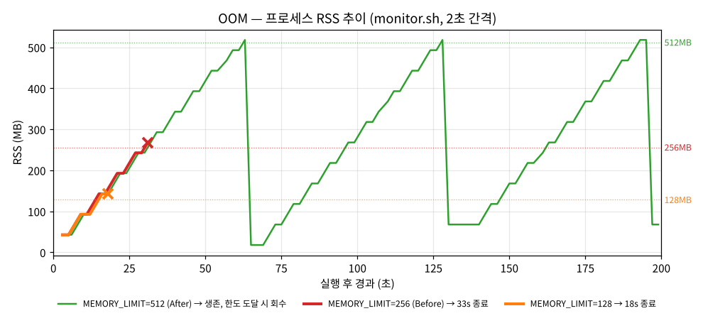

# [Bug] OOM - 실행 33초 후 MemoryGuard 가 프로세스를 SIGKILL 로 자체 종료 (메모리 누수)

| 항목 | 값 |
| --- | --- |
| 대상 | `agent-leak-app-x86` (PyInstaller 단일 바이너리, 부모 부트로더 + 자식 앱 프로세스) |
| 환경 | Ubuntu 24.04, 2 vCPU / 8GB / swap 없음, 실행 계정 `agent-admin` |
| 재현 조건 | `MEMORY_LIMIT=256` `CPU_MAX_OCCUPY=50` `MULTI_THREAD_ENABLE=false` |
| 재현율 | 3/3 (33s · 33s · 34s) |
| 영향 | 서비스 프로세스가 예고 없이 사라짐 (SIGKILL → 정리 작업 없이 즉시 종료) |

## 1. Description (현상 설명)

- 앱을 시작하면 약 **33초 뒤** 프로세스가 사라지고 종료 코드 **137**(= 128 + SIGKILL)로 끝납니다.
- 부팅 화면에서 이미 경고가 나옵니다: `[ MEMORY ] Limit: 256MB   [ WARNING: Recommend Over 256MB ]`
- 같은 설정으로 3번 실행해 모두 33~34초에 종료됐습니다. 우연이 아니라 **설정값에 비례하는 결정적 장애**입니다.
- CPU 는 0~1.5% 로 평온했고 시스템 전체 메모리도 7~8% 만 사용 중이었습니다. 시스템 자원이 부족해서가 아니라 **이 프로세스 하나의 메모리가 계속 늘어난 것**이 문제입니다.

## 2. Evidence & Logs (증거 자료)

### 2-1. monitor.sh 관제 — RSS 가 선형으로 증가

`tools/monitor.sh --interval 2` (프로세스 단위, `/proc/<pid>/status` VmRSS) · [`evidence/oom-before/20261012-223103/monitor.log`](../evidence/oom-before/20261012-223103/monitor.log)

```text
[2026-10-12 22:31:06] PROCESS:agent-leak-app PID:3848 STATE:S CPU:0.5% MEM:0.5% RSS:42.6MB  THREADS:1 SYS_MEM:6.6%
[2026-10-12 22:31:10] PROCESS:agent-leak-app PID:3848 STATE:S CPU:0.0% MEM:0.8% RSS:67.6MB  THREADS:1
[2026-10-12 22:31:16] PROCESS:agent-leak-app PID:3848 STATE:S CPU:0.5% MEM:1.5% RSS:117.6MB THREADS:1
[2026-10-12 22:31:22] PROCESS:agent-leak-app PID:3848 STATE:S CPU:0.0% MEM:2.1% RSS:167.6MB THREADS:1
[2026-10-12 22:31:28] PROCESS:agent-leak-app PID:3848 STATE:S CPU:0.5% MEM:2.7% RSS:217.6MB THREADS:1
[2026-10-12 22:31:34] PROCESS:agent-leak-app PID:3848 STATE:S CPU:1.0% MEM:3.3% RSS:267.6MB THREADS:1
[2026-10-12 22:31:36] PROCESS:agent-leak-app PID:3848 STATE:GONE
```

| 구간 | RSS | 증가 속도 |
| --- | --- | --- |
| 22:31:06 → 22:31:34 (28초) | 42.6 → 267.6 MB | **+225 MB / 28s ≈ 8.0 MB/s**, 해제 없이 계단식 증가 |



> 그래프: `tools/plot-evidence.py` 가 위 monitor.log 3개를 그대로 그린 것. 세 실행 모두 **같은 기울기**로 오르고, 128·256 은 한도 직후 사라지며(×), 512 는 한도에서 회수 후 다시 오르는 톱니 모양입니다.

> MEM% 는 시스템 전체(8GB) 대비라 3.3% 로 작아 보입니다. 판단은 **RSS(MB)의 기울기**와 앱 한도(256MB) 기준으로 했습니다.

### 2-2. top 배치 출력 — 같은 PID 의 RES 증가 (교차 확인)

`top -b -d 5 -p <PID>` · [`evidence/oom-before/20261012-225151/top.txt`](../evidence/oom-before/20261012-225151/top.txt)

```text
  PID USER      PR  NI    VIRT    RES    SHR S  %CPU  %MEM     TIME+ COMMAND
27157 agent-a+  30  10   48344  43636   9660 S   0.0   0.5   0:00.07 agent-lea+
27157 agent-a+  30  10   99552  94844   9660 S   0.6   1.2   0:00.10 agent-lea+
27157 agent-a+  30  10  150760 146052   9660 S   0.4   1.8   0:00.12 agent-lea+
27157 agent-a+  30  10  227572 222864   9660 S   0.6   2.7   0:00.16 agent-lea+
27157 agent-a+  30  10  278780 274072   9660 S   0.6   3.3   0:00.19 agent-lea+
```

VIRT 와 RES 가 함께 늘어납니다 → 새로 할당한 메모리를 **실제로 사용(touch)** 하고 있어 물리 메모리가 계속 점유됩니다.

### 2-3. 프로그램 실행 로그 — 종료 직전·직후

[`evidence/oom-before/20261012-223103/app.log`](../evidence/oom-before/20261012-223103/app.log)

```text
2026-10-12 22:31:05,573 [INFO] [MemoryWorker] Current Heap: 25MB
2026-10-12 22:31:08,603 [INFO] [MemoryWorker] Current Heap: 50MB         ← 3.03초마다 +25MB
   …
2026-10-12 22:31:32,822 [INFO] [MemoryWorker] Current Heap: 250MB
2026-10-12 22:31:35,851 [INFO] [MemoryWorker] Current Heap: 275MB
2026-10-12 22:31:35,852 [CRITICAL] [MemoryGuard] Memory limit exceeded (275MB >= 256MB) / (Recommend Over 256MB)
2026-10-12 22:31:35,852 [CRITICAL] [MemoryGuard] Self-terminating process 3848 to prevent system instability.
```

`Self-terminating process 3848` 의 3848 은 monitor.sh 가 추적한 PID 와 같습니다 → 관제 대상과 로그의 주체가 동일 프로세스임을 확인.

### 2-4. 누가 죽였나 — strace 로 신호 출처 확인

`run-scenario.sh --trace` (앱을 `strace -f -e trace=kill,tgkill,exit_group` 의 자식으로 실행) · [`evidence/oom-before/20261012-223140/trace.txt`](../evidence/oom-before/20261012-223140/trace.txt)

```text
4676  22:32:13.099574 kill(4676, SIGKILL) = ?                        ← 앱(4676)이 자기 자신에게 SIGKILL
4676  22:32:13.119066 +++ killed by SIGKILL +++
4610  22:32:13.119249 --- SIGCHLD {si_code=CLD_KILLED, si_pid=4676, si_status=SIGKILL, …} ---
4610  22:32:13.145051 tgkill(4610, 4610, SIGKILL) = ?                ← 부트로더(4610)도 같은 신호로 스스로 종료
4610  22:32:13.145449 +++ killed by SIGKILL +++
```

| 판별 | 결과 |
| --- | --- |
| 커널 OOM Killer 인가? | **아니다.** 커널이 죽였다면 시스템 콜 없이 `+++ killed by SIGKILL +++` 만 보이고 시스템 메모리가 고갈 직전이어야 한다. 여기서는 **앱이 `kill(자기 PID, SIGKILL)` 을 직접 호출**했고 시스템 메모리 사용률은 7~8% 였다 |
| 외부에서 kill 했나? | 아니다. `kill()` 의 호출자와 대상이 같은 PID |
| 결론 | **애플리케이션 내부 정책(MemoryGuard)에 의한 자체 종료** |

### 2-5. 한도를 바꿔 본 보조 실험 — 생존 시간 ∝ MEMORY_LIMIT

| 실행 | MEMORY_LIMIT | 생존 | 종료 시 Heap | 종료 |
| --- | --- | --- | --- | --- |
| [`oom-128`](../evidence/oom-128/20261012-223217/result.txt) | 128 | **18s** | 150MB ≥ 128MB | 137 SIGKILL |
| [`oom-before` #1](../evidence/oom-before/20261012-223103/result.txt) | 256 | **33s** | 275MB ≥ 256MB | 137 SIGKILL |
| [`oom-before` #2](../evidence/oom-before/20261012-223140/result.txt) (trace) | 256 | **33s** | 275MB ≥ 256MB | 137 SIGKILL |
| [`oom-before` #3](../evidence/oom-before/20261012-225151/result.txt) (top) | 256 | **34s** | 275MB ≥ 256MB | 137 SIGKILL |

25MB × n ≥ 한도 가 되는 첫 단계에서 종료됩니다(128 → 6단계 ≈ 18s, 256 → 11단계 ≈ 33s). **누수 속도는 일정하고, 한도만이 죽는 시점을 결정**한다는 뜻입니다.

## 3. Root Cause Analysis (원인 분석)

**결함: MemoryWorker 의 메모리 누수 (할당 후 해제하지 않음)**
- Heap 이 3.03초마다 정확히 25MB 씩 늘고 줄지 않습니다(2-3). RSS·RES 도 같은 기울기로 늘어납니다(2-1, 2-2).
- 일시적 사용량 증가라면 처리 후 줄어들어야 하는데, 22:31:05~35 동안 한 번도 줄지 않았습니다 → 참조가 계속 남아 GC 가 회수하지 못하는 **누적형 누수**입니다(예: 전역 리스트·캐시에 계속 추가).

**종료 메커니즘: MemoryGuard 의 fail-fast 정책**
- Heap 이 `MEMORY_LIMIT` 이상이 되는 순간 MemoryGuard 가 `kill(getpid(), SIGKILL)` 로 자기 자신을 종료합니다(2-4).

**왜 앱이 스스로 죽는가 — OS 관점**
1. 누수가 계속되면 RSS 가 물리 메모리를 잠식합니다. 커널은 먼저 페이지 캐시를 비우고, swap 이 있으면 swap 으로 밀어내며(디스크 I/O 폭증 → 시스템 전체가 느려지는 thrashing), 그래도 부족하면 **커널 OOM Killer** 가 `oom_score`(대략 메모리 점유가 큰 순)가 가장 높은 프로세스를 SIGKILL 합니다.
2. 커널 OOM Killer 는 **어떤 프로세스를 죽일지 앱이 고를 수 없습니다.** 누수 프로세스가 아닌 DB·sshd 같은 다른 중요한 프로세스가 희생될 수도 있고, 그 전에 thrashing 으로 서버 전체가 응답하지 않을 수 있습니다.
3. MemoryGuard 는 그 지점에 도달하기 **전에**, 원인 프로세스 스스로 정해진 한도에서 종료해 **피해를 자기 자신으로 한정**합니다. 시스템 메모리가 7~8% 일 때 종료된 것도 이 때문입니다.
4. SIGKILL 은 잡거나 무시할 수 없는 신호라 확실히 종료되지만, 종료 처리(버퍼 플러시, 연결 정리)가 실행되지 않습니다. 그래서 종료 로그가 마지막 2줄에서 끊깁니다.

## 4. Workaround & Verification (조치 및 검증)

### 조치

`MEMORY_LIMIT` **하나만** 256 → 512 로 올렸습니다. (다른 값은 동일: [`scenarios/oom-before.env`](../scenarios/oom-before.env) → [`scenarios/oom-after.env`](../scenarios/oom-after.env))

```bash
# 운영 환경이라면 실행 계정의 환경 파일에서 변경 (예: ~/.bash_profile 또는 /etc/agent-app/agent-app.env)
export MEMORY_LIMIT=512
```

### Before & After

| | Before (`MEMORY_LIMIT=256`) | After (`MEMORY_LIMIT=512`) |
| --- | --- | --- |
| 부팅 판정 | `[ WARNING: Recommend Over 256MB ]` | `[ OK ]`, 시나리오 `Healthy System Monitoring` |
| 생존 시간 | **33s / 33s / 34s** 후 종료 | **300s 관찰 내내 생존** (관찰 종료로 정지) |
| 종료 | 137 (SIGKILL, 자체 종료) | 없음 |
| 한도 도달 시 동작 | `Self-terminating process` | `Memory Usage Reached Limit (525MB). Starting cleanup...` → `Memory Cache Flushed. Process Stabilized.` |
| RSS 패턴 | 42 → 268MB 직선 상승 후 사라짐 | **17.8 ↔ 517.9MB 톱니 모양** (약 65초 주기, 5분간 4회 회수) |

After 실행 로그 ([`evidence/oom-after/20261012-223240/app.log`](../evidence/oom-after/20261012-223240/app.log)):

```text
2026-10-12 22:33:44,571 [WARNING] [MemoryWorker] Memory Usage Reached Limit (525MB). Starting cleanup...
2026-10-12 22:33:44,601 [INFO] [System] Memory Cache Flushed. Process Stabilized.
>>> [SYSTEM] MEMORY RECOVERED (Cache Cleared) <<<
2026-10-12 22:34:50,210 [WARNING] [MemoryWorker] Memory Usage Reached Limit (525MB). Starting cleanup...
2026-10-12 22:35:55,847 [WARNING] [MemoryWorker] Memory Usage Reached Limit (525MB). Starting cleanup...
2026-10-12 22:37:01,461 [WARNING] [MemoryWorker] Memory Usage Reached Limit (525MB). Starting cleanup...
```

비교표 원본: `tools/compare.sh evidence/oom-before/* evidence/oom-128/* evidence/oom-after/*`

### 해석과 한계

- 한도를 올린 것은 **임시 조치**입니다. 누수 속도(≈8MB/s)는 그대로이고, After 에서도 65초마다 512MB 까지 차오릅니다. 한도를 올린 만큼 "죽기까지의 시간"·"회수 주기" 가 늘어났을 뿐 원인은 남아 있습니다.
- 서버 메모리가 작거나 같은 서버에 다른 프로세스가 있으면, 높아진 한도까지 쓰는 동안 다른 프로세스가 압박을 받습니다. 한도는 **서버 여유 메모리 - 다른 프로세스 사용량** 안에서 정해야 합니다.

### 근본 해결 제안 (코드 레벨)

1. 누적 컨테이너(리스트·dict 캐시)에 **상한과 만료**를 둔다: `collections.deque(maxlen=N)`, `functools.lru_cache(maxsize=N)`, TTL 캐시
2. 처리 끝난 데이터의 참조를 끊는다(`del`, `pop`, 컨텍스트 매니저). 큰 버퍼는 재사용
3. `tracemalloc` 스냅샷 비교로 증가하는 할당 위치를 찾아 테스트로 고정 (메모리 회귀 테스트)
4. SIGKILL 대신 **SIGTERM → 유예 → SIGKILL** 순서로 종료해 진행 중 작업을 정리할 기회를 준다
5. 운영: 컨테이너/systemd `MemoryMax` 로 OS 수준 상한을 함께 걸고, monitor.sh 에 **RSS 기울기 경고**(예: 10분 연속 증가 + 증가율 > X MB/분)를 추가해 한도 도달 **전에** 알림

## 재현 방법

```bash
sudo -iu agent-admin
cd <repo>
tools/run-scenario.sh scenarios/oom-before.env            # 약 35초, exit 137
tools/run-scenario.sh scenarios/oom-before.env --trace    # + strace 신호 기록
tools/run-scenario.sh scenarios/oom-after.env --max 300   # 5분 생존 확인
```
