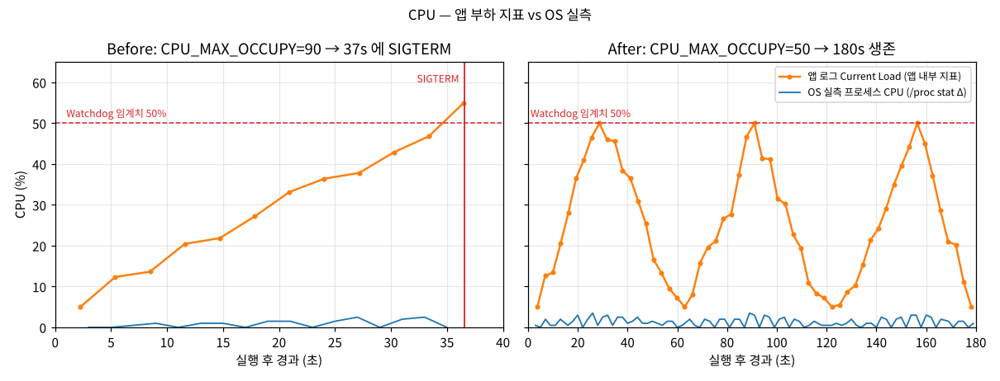

# [Bug] CPU - 부하가 Watchdog 임계치(50%)를 넘는 순간 SIGTERM 으로 자체 종료 (CPU_MAX_OCCUPY 과설정)

| 항목 | 값 |
| --- | --- |
| 작성 템플릿 | [`.github/ISSUE_TEMPLATE/bug_report.md`](../.github/ISSUE_TEMPLATE/bug_report.md) — GitHub 에서 New issue 를 누르면 같은 구조로 뜸 |
| 대상 | `agent-leak-app-x86` (부모 부트로더 + 자식 앱 프로세스) |
| 환경 | Ubuntu 24.04, 2 vCPU / 8GB, 실행 계정 `agent-admin` |
| 재현 조건 | `CPU_MAX_OCCUPY=90` `MEMORY_LIMIT=512` `MULTI_THREAD_ENABLE=false` |
| 재현율 | 3/3 (37s · 25s · 31s), 경계 실험 `CPU_MAX_OCCUPY=60` 도 24s 에 종료 · 동료 평가 후 자동 반복에서 51~90 **15/15 종료**, 50 **0/3 종료** ([4장](#자동-반복-실행--안정-케이스와-경계-케이스)) |
| 치명도 | **Sev3 (권장)**, 대체 인스턴스 없이 서비스가 멈추면 Sev2 — SIGTERM 이라 정리 기회가 있고 OS 자원은 거의 쓰지 않음(다른 프로세스 지연 변화 없음, 4장). 기준: [runbook 1절](../docs/runbook.md#1-장애-유형별-치명도와-대응-sla) · 다른 장애와 겹치면: [우선순위 규칙](README.md#동시-장애가-겹칠-때) |
| 영향 | 서비스 프로세스가 실행 25~37초 만에 종료 (종료 코드 143) |

## 1. Description (현상 설명)

- 앱을 시작하면 CpuWorker 의 부하가 3초마다 계단식으로 오르다가 **50% 를 넘는 첫 순간** `[CRITICAL] [CpuWorker] CPU Threshold Violated!` 를 남기고 약 0.1초 뒤 종료됩니다. 종료 코드는 **143**(= 128 + SIGTERM)입니다.
- 부팅 화면이 이미 경고합니다: `[ CPU    ] Limit: 90%  [ WARNING: Recommend Under 50% ]`
- 생존 시간은 25~37초로 실행마다 다릅니다. 부하 상승폭이 단계마다 달라(+0.05 ~ +9.94%p) 50% 를 넘는 단계가 8~12번째로 바뀌기 때문입니다. **종료 조건(50% 초과)은 3번 모두 같습니다.**
- 같은 시각 시스템 전체 CPU(`SYS_CPU`)는 1~2%, 메모리는 6% 대로 평온했습니다. 서버 전체가 아니라 **이 프로세스의 부하 정책**이 원인입니다.

## 2. Evidence & Logs (증거 자료)

### 2-1. 프로그램 실행 로그 — 부하 상승 → 임계치 초과 → 종료

[`evidence/cpu-before/20261012-223757/app.log`](../evidence/cpu-before/20261012-223757/app.log) L17–43

```text
2026-10-12 22:37:57,241 [INFO] [SafetyGuard] Process priority lowered (nice=10).
 [ CPU    ] Limit: 90%  		[ WARNING: Recommend Under 50% ]
2026-10-12 22:37:59,251 [INFO] [CpuWorker] Started. Maximum CPU Limit: 90%
2026-10-12 22:37:59,251 [INFO] [CpuWorker] Current Load: 5.00%
2026-10-12 22:38:02,367 [INFO] [CpuWorker] Current Load: 12.34%        ← 약 3.1초마다 상승
2026-10-12 22:38:08,591 [INFO] [CpuWorker] Current Load: 20.46%
2026-10-12 22:38:17,926 [INFO] [CpuWorker] Current Load: 33.15%
2026-10-12 22:38:27,270 [INFO] [CpuWorker] Current Load: 42.90%
2026-10-12 22:38:30,383 [INFO] [CpuWorker] Current Load: 46.79%
2026-10-12 22:38:33,486 [INFO] [CpuWorker] Current Load: 54.96%        ← 처음으로 50% 초과
2026-10-12 22:38:33,587 [CRITICAL] [CpuWorker] CPU Threshold Violated! (54.959999999999994%).   ← 101ms 뒤 종료
```

> 미션 예시의 `WATCHDOG: INITIATING EMERGENCY ABORT (SIGTERM)` 문구는 이번 바이너리에서는 출력되지 않았습니다. 대신 `CPU Threshold Violated!` 직후 **SIGTERM 으로 종료**되는 것을 종료 코드(2-4)와 strace(2-5)로 확인했습니다.

### 2-2. 3회 반복 + 경계 실험 — 종료 시점의 부하는 항상 "50% 를 처음 넘은 값"

| 실행 | CPU_MAX_OCCUPY | 부하 추이 (`Current Load`, 3.1초 간격) | 종료 시 부하 | 생존 | 종료 |
| --- | --- | --- | --- | --- | --- |
| [`cpu-before` #1](../evidence/cpu-before/20261012-223757/result.txt) | 90 | 5.00 → 12.34 → … → 46.79 → **54.96** | 54.96% | **37s** | 143 SIGTERM |
| [`cpu-before` #2](../evidence/cpu-before/20261012-223838/result.txt) (trace) | 90 | 5.00 → 11.83 → … → 44.23 → **50.96** | 50.96% | **25s** | 143 SIGTERM |
| [`cpu-before` #3](../evidence/cpu-before/20261012-225108/result.txt) (top) | 90 | 5.00 → 12.94 → … → 45.69 → **52.22** | 52.22% | **31s** | 143 SIGTERM |
| [`cpu-60`](../evidence/cpu-60/20261012-223907/result.txt) (경계) | **60** | 5.00 → 8.39 → … → 42.96 → **51.07** | 51.07% | **24s** | 143 SIGTERM |

- 한도를 90 → 60 으로 낮춰도 죽습니다. 그리고 죽는 지점이 60% 가 아니라 **51.07%** 입니다.
- 즉 Watchdog 의 판정 기준은 `CPU_MAX_OCCUPY` 가 아니라 **고정 임계치 50%** 이고, `CPU_MAX_OCCUPY` 는 CpuWorker 가 **부하를 어디까지 올릴지(상한)** 를 정하는 값입니다. 상한이 임계치보다 높으면 언젠가 반드시 50% 를 넘습니다.

### 2-3. monitor.sh 관제 + top — 이 프로세스, 이 시점

`tools/monitor.sh --interval 2` · [`evidence/cpu-before/20261012-223757/monitor.log`](../evidence/cpu-before/20261012-223757/monitor.log) L1–18

```text
[2026-10-12 22:38:00] PROCESS:agent-leak-app PID:12051 STATE:S CPU:0.0% MEM:0.2% RSS:17.6MB THREADS:1 SYS_CPU:2.0% SYS_MEM:6.6% LOG_LINES:31
[2026-10-12 22:38:16] PROCESS:agent-leak-app PID:12051 STATE:S CPU:1.5% MEM:0.2% RSS:17.6MB THREADS:1 SYS_CPU:2.5% SYS_MEM:6.4% LOG_LINES:36
[2026-10-12 22:38:24] PROCESS:agent-leak-app PID:12051 STATE:S CPU:2.5% MEM:0.2% RSS:17.6MB THREADS:1 SYS_CPU:6.5% SYS_MEM:6.4% LOG_LINES:39
[2026-10-12 22:38:30] PROCESS:agent-leak-app PID:12051 STATE:S CPU:2.5% MEM:0.2% RSS:17.6MB THREADS:1 SYS_CPU:2.2% SYS_MEM:6.4% LOG_LINES:41
[2026-10-12 22:38:32] PROCESS:agent-leak-app PID:12051 STATE:S CPU:0.0% MEM:0.2% RSS:17.6MB THREADS:1 SYS_CPU:1.5% SYS_MEM:6.4% LOG_LINES:41
[2026-10-12 22:38:34] PROCESS:agent-leak-app PID:12051 STATE:GONE
```

`top -b -d 5 -p <PID>` · [`evidence/cpu-before/20261012-225108/top.txt`](../evidence/cpu-before/20261012-225108/top.txt) L8–53

```text
  PID USER      PR  NI    VIRT    RES    SHR S  %CPU  %MEM     TIME+ COMMAND
26244 agent-a+  30  10   23764  18156   9720 S   0.0   0.2   0:00.06 agent-lea+
26244 agent-a+  30  10   23764  18156   9720 S   0.4   0.2   0:00.11 agent-lea+
26244 agent-a+  30  10   23764  18156   9720 S   1.2   0.2   0:00.17 agent-lea+
26244 agent-a+  30  10   23764  18156   9720 S   1.4   0.2   0:00.24 agent-lea+
26244 agent-a+  30  10   23764  18156   9720 S   0.8   0.2   0:00.28 agent-lea+
```



**관찰 결과를 있는 그대로 적으면:**

| 지표 | 값 | 출처 |
| --- | --- | --- |
| 앱이 보고한 부하 | 5% → **54.96%** 로 단조 증가 | app.log `Current Load` |
| OS 가 측정한 이 프로세스의 CPU | **0~2.5%** (top 0.0~1.4%) | `/proc/<pid>/stat` Δ, `top` |
| 프로세스 총 CPU 시간 | 25초 생존 동안 **0.28초** (user 0.26 + sys 0.02) | strace `SIGCHLD si_utime=26 si_stime=2` (2-5) |
| 우선순위 | `PR 30 NI 10` — 시작 직후 스스로 nice 10 으로 낮춤 | top, app.log `SafetyGuard` |

- 이 바이너리의 `Current Load` 는 OS CPU 를 실제로 그만큼 태우지 않는 **앱 내부(시뮬레이션) 부하 지표**입니다. Watchdog 은 **이 내부 지표**로 판정합니다(OS 실측은 2.5% 를 넘은 적이 없는데 종료됨).
- 그래서 "특정 프로세스의 CPU 급상승 구간" 은 **앱 지표에서 식별**했고, OS 지표로는 "시스템 전체 과부하가 아니다(SYS_CPU 1~2%)" 와 "다른 프로세스가 원인이 아니다" 를 확인했습니다.
- 운영 관점의 교훈: 앱이 보고하는 지표와 OS 실측이 다를 수 있으므로 **둘 다 수집해야** 합니다. 보고서도 두 값을 나란히 둡니다.

**두 지표의 정량적 관계** — 관제 샘플마다 그 시각의 가장 최근 앱 `Current Load` 를 짝지어(앱 3.1초 · 관제 2초 간격) 실행 5회를 비교했습니다. 위 그래프가 같은 데이터를 시간축에 나란히 그린 것입니다.

| 실행 | 앱 지표 최대 | OS 실측 최대 · 평균 | 짝지은 샘플 | 상관계수 r |
| --- | ---: | --- | ---: | ---: |
| [`cpu-before/20261012-223757`](../evidence/cpu-before/20261012-223757/) | 54.96% | 2.5% · 0.88% | 17 | 0.46 |
| [`cpu-before/20261012-223838`](../evidence/cpu-before/20261012-223838/) | 50.96% | 2.5% · 0.82% | 11 | 0.41 |
| [`cpu-before/20261012-225108`](../evidence/cpu-before/20261012-225108/) | 52.22% | 2.0% · 0.82% | 14 | 0.33 |
| [`cpu-60/20261012-223907`](../evidence/cpu-60/20261012-223907/) | 51.07% | 2.0% · 0.68% | 11 | 0.34 |
| [`cpu-after/20261012-223936`](../evidence/cpu-after/20261012-223936/) | 50.00% | 3.5% · 1.28% | 93 | 0.40 |
| **5회 합침** | | | **146** | **0.37** |

합친 146쌍의 최소제곱 직선은 **OS 실측 ≈ 0.45 + 0.026 × 앱 지표**(%)입니다. 앱이 50% 를 보고할 때 OS 실측은 약 1.7% 로, 크기가 약 30배 다릅니다. 앱 지표가 25% 미만인 샘플(77개)의 OS 평균은 0.79%, 45% 이상(18개)은 1.64% 였습니다. 방향은 약하게 같이 움직이지만(r 0.33~0.46), **앱 지표 50% 는 실제 CPU 50% 가 아닙니다**. 4장의 "다른 프로세스 지연 변화 없음" 측정과도 일치합니다.

### 2-4. 종료 코드

```text
$ cat evidence/cpu-before/20261012-223757/result.txt
survival      : 37s
exit_code     : 143 (128 + SIGTERM)
last_app_log  : 2026-10-12 22:38:33,587 [CRITICAL] [CpuWorker] CPU Threshold Violated! (54.959999999999994%).
```

### 2-5. 누가 죽였나 — strace

`run-scenario.sh --trace` · [`evidence/cpu-before/20261012-223838/trace.txt`](../evidence/cpu-before/20261012-223838/trace.txt) L1–5

```text
12953 22:39:02.536661 kill(12953, SIGTERM) = 0                                   ← 앱(12953)이 자기 자신에게 SIGTERM
12953 22:39:02.536814 --- SIGTERM {si_code=SI_USER, si_pid=12953, si_uid=30033} ---  ← 보낸 쪽 PID = 자기 자신
12953 22:39:02.538887 +++ killed by SIGTERM +++
12880 22:39:02.539027 --- SIGCHLD {si_code=CLD_KILLED, si_pid=12953, si_status=SIGTERM, si_utime=26 /* 0.26 s */, si_stime=2 /* 0.02 s */} ---
12880 22:39:02.556075 tgkill(12880, 12880, SIGTERM) = 0                          ← 부트로더도 같은 신호로 종료
```

`CPU Threshold Violated!` 로그(22:39:02,533) → 3ms 뒤 `kill(자기 PID, SIGTERM)`. 외부(관리자·커널)가 아니라 **앱 내부 Watchdog 정책에 의한 의도된 종료**입니다. 오류로 인한 크래시였다면 SIGSEGV/SIGABRT 나 Traceback 이 남았을 것입니다.

## 3. Root Cause Analysis (원인 분석)

**직접 원인: `CPU_MAX_OCCUPY`(부하 상한)가 Watchdog 임계치(50%)보다 높게 설정됨**

```
CpuWorker:  부하 5% → 약 3.1초마다 상승 → 상한(CPU_MAX_OCCUPY)에 닿으면 5% 까지 쿨다운 → 반복
Watchdog :  부하 > 50% 이면 → CRITICAL 로그 → kill(getpid(), SIGTERM)
```

| CPU_MAX_OCCUPY | 부하가 오를 수 있는 최대값 | 50% 초과 가능? | 결과 |
| --- | --- | --- | --- |
| 90 | 90% | 예 | 50% 를 넘는 첫 단계에서 종료 (25~37s) |
| 60 | 60% | 예 | 51.07% 에서 종료 (24s) |
| **50** | **50.00%** | **아니오 (같을 뿐 넘지 않음)** | `Peak reached (50.00%)` → 쿨다운 → 생존 |

판정이 "50% 이상" 이 아니라 **"50% 초과"** 라는 것도 After 실행에서 확인됩니다. 부하가 정확히 50.00% 에 3번 도달했지만 종료되지 않았습니다.

**왜 CPU 과점유 프로세스 하나를 종료하는 것이 시스템 보호인가 — OS 관점**

1. **CPU 는 시간을 나눠 쓰는 자원입니다.** 리눅스 CFS 스케줄러는 실행 가능한(R) 프로세스들에게 가중치(nice)에 비례해 CPU 시간을 나눕니다. 한 프로세스가 계속 계산만 하면(CPU-bound) 코어를 내주는 순간이 적어지고, run queue 가 길어져 **다른 모든 프로세스의 응답 지연(latency)** 이 커집니다. 2 vCPU 서버라면 스레드 2개만 바쁘게 돌아도 sshd·웹 서버·DB 가 "느려지거나 멈춘 것처럼" 보입니다.
2. **메모리와 달리 CPU 과점유는 커널이 대신 끊어 주지 않습니다.** 메모리는 바닥나면 커널 OOM Killer 가 개입하지만, CPU 는 아무리 바빠도 커널이 프로세스를 죽이지 않고 **모두를 조금씩 느리게** 만들 뿐입니다. 그래서 응용 계층의 Watchdog(또는 cgroup `cpu.max`, systemd `CPUQuota`)이 상한을 지켜야 합니다.
3. **원인 하나를 끊으면 나머지가 산다.** 폭주한 1개를 종료하면 run queue 가 즉시 비워져 다른 서비스의 지연이 회복됩니다. 재시작은 프로세스 관리자(systemd `Restart=on-failure`)가 맡으면 됩니다. "1개를 희생해 N개를 지킨다" 는 판단입니다.
4. **이 앱의 2중 보호:** 시작 직후 `SafetyGuard` 가 자기 nice 를 10 으로 낮춥니다(top `NI 10`). nice 10 의 CFS 가중치는 110 으로 nice 0(1024)의 약 1/9 이라, 경쟁이 생기면 **다른 프로세스에게 먼저 양보**합니다. 그래도 부하가 임계치를 넘으면 Watchdog 이 종료합니다.
5. **SIGTERM 을 쓰는 이유:** MemoryGuard 는 SIGKILL(즉시)이었지만 Watchdog 은 SIGTERM 입니다. 메모리 고갈은 몇 초 안에 서버 전체를 멈추게 할 수 있어 즉시 끊어야 하지만, CPU 과점유는 느려질 뿐 당장 무너지지 않으므로 **정리 작업(핸들러, 버퍼 플러시)의 기회를 주는 정상 종료 신호**가 적절합니다.

## 4. Workaround & Verification (조치 및 검증)

### 조치

`CPU_MAX_OCCUPY` **하나만** 90 → 50 으로 내렸습니다(권장값 `Recommend Under 50%`). 다른 값은 동일: [`scenarios/cpu-before.env`](../scenarios/cpu-before.env) → [`scenarios/cpu-after.env`](../scenarios/cpu-after.env)

```bash
export CPU_MAX_OCCUPY=50
```

**변경 위치와 명령** — 값이 들어 있는 곳은 세 군데이고, 어느 경우든 앱은 시작할 때만 환경변수를 읽으므로 **재시작해야** 적용됩니다.

| 어디서 | 위치 | 명령 |
| --- | --- | --- |
| 이 저장소의 실험 | [`scenarios/cpu-before.env`](../scenarios/cpu-before.env#L4) 4줄 `CPU_MAX_OCCUPY=90` → [`scenarios/cpu-after.env`](../scenarios/cpu-after.env#L3) 3줄 `CPU_MAX_OCCUPY=50` | `tools/run-scenario.sh scenarios/cpu-after.env` |
| 같은 파일을 바꿔서 검증 (백업 · 롤백 포함) | `scenarios/cpu-before.env` | `tools/apply-env.sh scenarios/cpu-before.env CPU_MAX_OCCUPY=50 --verify 60` → 나쁘면 `tools/apply-env.sh --rollback scenarios/cpu-before.env` |
| 운영 서버 | 실행 계정의 환경 파일(예: `/etc/agent-app/agent-app.env`) 또는 systemd 유닛의 `Environment=CPU_MAX_OCCUPY=50` | `tools/apply-env.sh /etc/agent-app/agent-app.env CPU_MAX_OCCUPY=50` 후 서비스 재시작 |


### Before & After

| | Before (`CPU_MAX_OCCUPY=90`) | After (`CPU_MAX_OCCUPY=50`) |
| --- | --- | --- |
| 부팅 판정 | `[ WARNING: Recommend Under 50% ]` | `[ OK ]`, `Healthy System Monitoring` |
| 부하 패턴 | 5% → 50.96~54.96% 단조 증가 후 종료 | **5% ↔ 50.00% 반복** (상승 24~34초, 쿨다운 31~34초, 약 62~65초 주기) |
| 상한 도달 시 | `CPU Threshold Violated!` → SIGTERM | `Peak reached (50.00%). Starting cooldown...` → `Cooldown complete (5.00%)` |
| 생존 시간 | **37s / 25s / 31s** | **180s 관찰 내내 생존** (관찰 종료로 정지) |
| 종료 코드 | 143 (자체 SIGTERM) | 없음 (관찰자가 정리) |
| OS 실측 CPU | 0~2.5% | 0~3.5% |

After 실행 로그 ([`evidence/cpu-after/20261012-223936/app.log`](../evidence/cpu-after/20261012-223936/app.log) L53–166):

```text
2026-10-12 22:39:39,754 [INFO] [CpuWorker] Started. Maximum CPU Limit: 50%
2026-10-12 22:40:01,555 [INFO] [CpuWorker] Current Load: 46.54%
2026-10-12 22:40:03,666 [INFO] [CpuWorker] Peak reached (50.00%). Starting cooldown...
2026-10-12 22:40:35,826 [INFO] [CpuWorker] Current Load: 7.28%
2026-10-12 22:40:37,934 [INFO] [CpuWorker] Cooldown complete (5.00%). Resuming load increase...
2026-10-12 22:41:05,978 [INFO] [CpuWorker] Peak reached (50.00%). Starting cooldown...
2026-10-12 22:41:37,139 [INFO] [CpuWorker] Cooldown complete (5.00%). Resuming load increase...
2026-10-12 22:42:11,392 [INFO] [CpuWorker] Peak reached (50.00%). Starting cooldown...
```

추가로, 같은 After 설정(`cpu-after.env`)으로 5번 더 실행한 [스케줄링 분석용 실행](../evidence/schedule-runs/cpu-after/)과 [OOM After](../evidence/oom-after/20261012-223240/result.txt) · [Deadlock After](../evidence/deadlock-after/20261012-224440/result.txt) 실행(모두 `CPU_MAX_OCCUPY=50`)에서도 CPU 로 인한 종료는 한 번도 없었습니다.

### 자동 반복 실행 — 안정 케이스와 경계 케이스

환경 파일을 바꾼 뒤 사람이 한 번 돌려 보는 대신, [`tools/sweep.sh`](../tools/sweep.sh) 가 `CPU_MAX_OCCUPY` 만 바꾼 env 를 만들어 값마다 3회씩 실행하고 요약합니다(동료 평가 후, 재현 컨테이너). 원본: [`evidence/followup/sweep-cpu/`](../evidence/followup/sweep-cpu/summary.md)

```bash
tools/sweep.sh scenarios/cpu-before.env CPU_MAX_OCCUPY 50 51 55 60 70 90 --repeat 3 --max 120
```

| `CPU_MAX_OCCUPY` | 구분 | 실행 | 종료 (exit 143) | 120초 생존 | 생존 시간 최소 / 중앙 / 최대 | 평균 ± 표준편차 | 종료 직전 부하 (위반 값) |
| --- | --- | ---: | ---: | ---: | --- | --- | --- |
| **50** | 안정 | 3 | 0 | **3** | 120s 관찰 내내 | — (전부 생존) | 50.00% 에서 쿨다운 반복 |
| **51** | 경계 (+1) | 3 | **3** | 0 | 24 / 34 / 41s | 33.0 ± 8.5s | 51.00% · 51.00% · 51.00% |
| 55 | 경계 | 3 | 3 | 0 | 27 / 31 / 38s | 32.0 ± 5.6s | 53.11% · 55.00% · 53.24% |
| 60 | 경계 | 3 | 3 | 0 | 27 / 28 / 31s | 28.7 ± 2.1s | 52.71% · 50.79% · 50.71% |
| 70 | 과설정 | 3 | 3 | 0 | 21 / 31 / 44s | 32.0 ± 11.5s | 55.36% · 54.08% · 54.06% |
| 90 | 과설정 (Before) | 3 | 3 | 0 | 24 / 34 / 38s | 32.0 ± 7.2s | 52.54% · 55.05% · 53.40% |
| **51~90 합침** | | 15 | **15** | 0 | 21 / **31** / 44s | **31.5 ± 6.7s** | 모두 50% 초과 |
| (원래 VM, 90) | Before 3회 | 3 | 3 | 0 | 25 / 31 / 37s | 31.0 ± 6.0s | 54.96% · 50.96% · 52.22% |

표준편차는 표본 표준편차(n−1)입니다. 값마다 3회뿐이라 평균 차이(28.7~33.0s)는 표준편차 안에 들어가고, **설정값에 따라 생존 시간이 달라진다고 볼 근거는 없습니다**. 51~90 을 합친 15회의 중앙값 31s 는 원래 VM 3회의 중앙값 31s 와 같습니다. 생존 시간은 설정값이 아니라 앱 부하가 50% 를 처음 넘는 단계(무작위 상승폭)가 정합니다. 요약표는 `tools/sweep.sh --summary` 가 평균 ± 표준편차까지 계산합니다.

- **임계치는 설정값과 무관하게 50% 초과**입니다. 51 이면 부하가 51.00% 에 닿는 순간 `Peak reached (51.00%). Starting cooldown...` 을 찍고도 0.1초 뒤 `CPU Threshold Violated! (51%)` 로 종료됩니다. 쿨다운이 시작돼도 이미 50 을 넘었기 때문입니다([`evidence/followup/sweep-cpu/cpu-before_CPU_MAX_OCCUPY=51/20261110-104955/app.log`](../evidence/followup/sweep-cpu/cpu-before_CPU_MAX_OCCUPY=51/20261110-104955/app.log)).
- 50 은 3회 모두 50.00% 에서 쿨다운하고 생존 → "50 이하" 가 안전 조건이며, 원래 실험(180초 생존)과 같습니다.

### 종료 직전 PID · 부하 값

앱 로그의 종료 줄(`CPU Threshold Violated!`)에는 PID 가 없습니다(MemoryGuard 의 `Self-terminating process <PID>` 와 다름). 그래서 종료 로그와 PID 를 잇는 데 strace(2-5)나 ps 스냅샷을 손으로 맞춰야 했습니다.

- **앱 쪽 권장(코드 수정, 제안 단계):** 종료 직전 한 줄에 PID · 신호 · 직전 N개 부하를 함께 남깁니다.
  ```text
  2026-10-12 22:38:33,587 [CRITICAL] [CpuWorker] CPU Threshold Violated! pid=12051 load=54.96% threshold=50% last=[42.90, 46.79, 54.96] action=SIGTERM
  ```
- **지금 할 수 있는 것(구현):** 앱은 바꿀 수 없으므로 `run-scenario.sh` 가 **관제가 잡은 앱 PID 와 종료 직전 N개(기본 5) 부하 값**을 `result.txt` 에 함께 남깁니다(`LAST_N` 으로 조정). 시작 직후의 PID 는 `ps.csv`(epoch 포함)에도 남아, 로그 시각 · 관제 CSV 와 자동으로 이어 붙일 수 있습니다.

```text
experiment    : cpu-before_CPU_MAX_OCCUPY=51-20261110-104955
app_pid       : 54  (관제 대상 = 실제 앱 프로세스)
interval      : 2s
start         : 2026-11-10 10:49:55
end           : 2026-11-10 10:50:36
survival      : 41s
exit_code     : 143 (128 + SIGTERM)
last_loads    : 37.75% 39.89% 49.32% 50.00% 51.00%  (앱 Current Load, 종료 직전 최대 5개)
last_app_log  : 2026-11-10 10:50:35,447 [CRITICAL] [CpuWorker] CPU Threshold Violated! (51%).
```

### 다른 프로세스에 미치는 영향 (latency)

"CPU 과점유" 라는 이름과 달리, 같은 머신의 다른 프로세스가 느려지는지 직접 쟀습니다. [`tools/latency-probe.sh`](../tools/latency-probe.sh) 가 0.5초마다 ① 로컬 웹 서버(`python3 -m http.server`)에 HTTP 요청 왕복 시간, ② `sleep 0.1` 이 실제로 더 걸린 시간(깨어나 CPU 를 다시 받기까지의 스케줄링 지연)을 기록합니다. 재현 컨테이너(2 vCPU), 원본: [`evidence/followup/latency/`](../evidence/followup/latency/)

| 구간 | 샘플 | HTTP 왕복 p50 / p95 / max (ms) | 스케줄링 지연 p50 / p95 / max (ms) |
| --- | ---: | --- | --- |
| 앱 없음 (기준) | 76 | 1.20 / 1.43 / 1.59 | 4.21 / 5.07 / 5.29 |
| CPU Before 실행 중 (전 구간 30초) | 59 | 1.29 / 1.48 / 1.50 | 4.14 / 5.14 / 5.76 |
| 그중 앱 부하 ≥ 40% 구간 (종료 직전) | 7 | 1.26 / 1.41 / 1.46 | 3.99 / 4.05 / 4.18 |
| **대조군**: 실제로 CPU 를 쓰는 프로세스 4개 (2 vCPU) | 52 | 1.24 / 1.56 / 1.82 | 4.60 / **57.84** / **65.22** |

- 앱이 "과점유" 를 보고하는 동안에도 다른 프로세스의 지연은 기준과 같습니다(차이는 측정 잡음 수준). OS 실측 CPU 가 0~2.5% 인 것(2-3)과 일치합니다.
- 대조군처럼 **실제로** CPU 를 점유하면 스케줄링 지연 p95 가 5ms → 58ms 로 10배 이상 늘어 탐침이 영향을 잡아낸다는 것도 확인했습니다. 따라서 "영향 없음" 은 측정 방법의 한계가 아니라 이 앱의 실제 특성입니다.
- 그래서 이 장애의 피해는 **이 프로세스 자신의 종료**이고, 시스템 전체 자원 고갈로 번지지 않습니다 → 치명도를 OOM 보다 낮게 둔 근거(머리 표).

### 해석과 한계

- `CPU_MAX_OCCUPY=50` 은 **부하가 임계치에 닿기만 하고 넘지 않게** 만드는 임시 조치입니다. 50.00% 는 임계치와 같은 값이라 여유(headroom)가 0 입니다. 운영이라면 40~45 처럼 **임계치보다 확실히 낮게** 두는 편이 안전합니다.
- 실제 부하(요청량)가 늘어나는 상황에서 상한만 낮추면 처리량이 떨어집니다. 상한은 "죽지 않게" 하는 값이지 "충분히 처리하게" 하는 값이 아닙니다.

### 근본 해결 제안 (코드 레벨)

1. **설정 검증:** 시작 시 `CPU_MAX_OCCUPY >= WATCHDOG_THRESHOLD` 이면 경고가 아니라 **기동 실패**(또는 자동 보정)로 처리. 지금은 경고만 찍고 30초 뒤 죽습니다
2. **즉사 대신 단계적 대응:** 1회 초과 즉시 종료하지 말고 "N초 연속 초과" 일 때만 개입(순간 스파이크 무시), 1단계는 작업 속도 조절(throttle), 2단계에서 종료
3. **CPU 사용을 OS 수준에서 제한:** 계산 루프를 작업 큐 + 고정 크기 워커 풀로 바꾸고, systemd `CPUQuota=50%` 또는 cgroup v2 `cpu.max` 로 커널이 상한을 강제하게 함
4. **지표 일치:** Watchdog 이 앱 내부 값이 아니라 `/proc/self/stat`(또는 `psutil.Process().cpu_percent()`) 실측으로 판정하게 하고, 두 값을 함께 로그로 남김
5. 종료 시 `CPU Threshold Violated` 뒤에 **신호 이름·PID·직전 N개 부하 값**을 남겨 재현 없이도 원인이 보이게 함 — 앱을 고치기 전까지는 `run-scenario.sh` 가 같은 정보를 `result.txt` 에 남김(4장 "종료 직전 PID · 부하 값")

## 재현 방법

```bash
sudo -iu agent-admin
cd <repo>
tools/run-scenario.sh scenarios/cpu-before.env            # 약 25~37초, exit 143
tools/run-scenario.sh scenarios/cpu-before.env --trace    # + strace 신호 기록
tools/run-scenario.sh scenarios/cpu-60.env                # 경계 실험: 60 도 종료
tools/run-scenario.sh scenarios/cpu-after.env --max 180   # 3분 생존 확인

# 재현 컨테이너에서 (바이너리 포함) — 안정/경계 자동 반복, 다른 프로세스 지연
repro/run.sh tools/sweep.sh scenarios/cpu-before.env CPU_MAX_OCCUPY 50 51 55 60 70 90 --repeat 3 --max 120
repro/run.sh tools/latency-probe.sh --duration 40 --out /work/latency.csv
```
