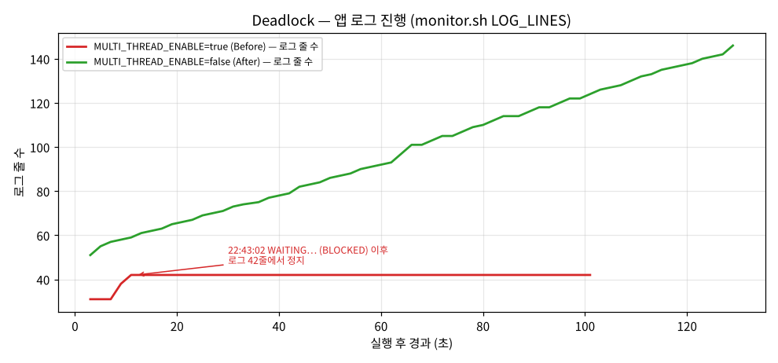

# [Bug] Deadlock - 동시성 모드에서 두 워커가 서로의 락을 기다리며 프로세스 무응답 (PID 유지, CPU 0, 로그 정지)

| 항목 | 값 |
| --- | --- |
| 작성 템플릿 | [`.github/ISSUE_TEMPLATE/bug_report.md`](../.github/ISSUE_TEMPLATE/bug_report.md) — GitHub 에서 New issue 를 누르면 같은 구조로 뜸 |
| 대상 | `agent-leak-app-x86` (부모 PID 17379 → 자식 PID 17428, 스레드 17428 · 17767 · 17768) |
| 환경 | Ubuntu 24.04, 2 vCPU / 8GB, 실행 계정 `agent-admin` |
| 재현 조건 | `MULTI_THREAD_ENABLE=true` `MEMORY_LIMIT=512` `CPU_MAX_OCCUPY=50` |
| 발생 시각 | 2026-10-12 22:43:02 (시작 9초 후) — 이후 관찰 종료(22:44:23)까지 **81초 이상 무진행** |
| 재현율 | **10/10** (`MULTI_THREAD_ENABLE=true`, 매번 시작 10초 뒤 정지) · `false` 는 **0/10** — [재현율 실험](#재현율-동시성-모드에서-몇-번-중-몇-번-나나) |
| 치명도 | **Sev1 (권장)** — PID 검사가 통과해 탐지가 늦고 자가 복구가 없음 (300초 관찰). 기준: [runbook 1절](../docs/runbook.md#1-장애-유형별-치명도와-대응-sla) |
| 영향 | 프로세스는 살아 있어 헬스체크(PID 존재)는 통과하지만 **아무 일도 하지 않음**. 종료 코드도, 에러 로그도 없음 |

## 1. Description (현상 설명)

- 앱이 시작 9초 만에 로그 출력을 멈췄습니다. 그런데 **프로세스는 종료되지 않습니다.** OOM·CPU 장애처럼 "사라지는" 것이 아니라 **"살아 있지만 멈춘"** 상태라 알아채기 가장 어렵습니다.
- 부팅 화면이 위험을 예고합니다.
  ```text
   [ THREAD ] Concurrency: True 		[ WARNING ]
   >>> SYSTEM WARNING: POTENTIAL DEADLOCK IN CONCURRENT MODE.
  2026-10-12 22:42:55,565 [WARNING] [System] CAUTION: Strict resource locking is enabled.
  ```
- 90초 동안 CPU 사용 0, RSS 17.7MB 고정, 로그 42줄 고정. 관찰자가 SIGTERM 을 보내기 전까지 스스로 회복하지 않았습니다.

## 2. Evidence & Logs (증거 자료)

### 2-1. PID 존재 — `ps -ef`, `pstree`

[`evidence/deadlock-before/20261012-224253/diagnose.txt`](../evidence/deadlock-before/20261012-224253/diagnose.txt) (멈추고 83초 뒤인 22:44:25 에 실행)

```text
$ ps -ef | grep '[a]gent-leak'
agent-a+ 17379 17368  0 22:42 ?        00:00:00 /home/agent-admin/agent-app/agent-leak-app-x86   ← 부트로더(부모)
agent-a+ 17428 17379  0 22:42 ?        00:00:00 /home/agent-admin/agent-app/agent-leak-app-x86   ← 앱(자식)

$ pstree -p 17379
agent-leak-app-(17379)---agent-leak-app-(17428)-+-{agent-leak-app-}(17767)     ← 워커 스레드 2개
                                                `-{agent-leak-app-}(17768)
```

`TIME 00:00:00` — 1분 30초를 살아 있는 동안 누적 CPU 시간이 1초도 안 됩니다.

### 2-2. CPU/MEM 변화 정체 — `ps -L`, `top -H`, 10초 간격 비교

```text
$ ps -L -o pid,tid,stat,pcpu,rss,wchan:20,comm -p 17428
  PID   TID STAT %CPU   RSS WCHAN                COMMAND
17428 17428 SNl   0.0 18100 futex_do_wait        agent-leak-app-      ← 메인 스레드
17428 17767 SNl   0.0 18100 futex_do_wait        agent-leak-app-      ← Worker-Thread-1
17428 17768 SNl   0.0 18100 futex_do_wait        agent-leak-app-      ← Worker-Thread-2

$ top -H -b -n 1 -p 17428
Threads:   3 total,   0 running,   3 sleeping,   0 stopped,   0 zombie
  PID USER      PR  NI    VIRT    RES    SHR S  %CPU  %MEM     TIME+ COMMAND
17428 agent-a+  30  10  171228  18100   9660 S   0.0   0.2   0:00.06 agent-lea+
17767 agent-a+  30  10  171228  18100   9660 S   0.0   0.2   0:00.00 agent-lea+
17768 agent-a+  30  10  171228  18100   9660 S   0.0   0.2   0:00.00 agent-lea+

===== 10초 간격 스냅샷 비교 (/proc/17428/task/*/stat) =====
TID      STATE1 STATE2       TICKS1       TICKS2    DELTA
17428    S      S                 6            6        0
17767    S      S                 0            0        0
17768    S      S                 0            0        0
CPU ticks 변화 합계 : 0  (CLK_TCK=100 → 0.00% CPU)
RSS                 : 18100kB → 18100kB (변화 0kB)
앱 로그 줄 수       : 42 → 42   마지막 수정: 2026-10-12 22:43:02 → 2026-10-12 22:43:02
```

| 단서 | 의미 |
| --- | --- |
| `STAT S` (전 스레드) | 실행 중(R)이 아니라 잠들어 있다 → 바쁜 무한 루프가 아니다 |
| `N` · `l` | nice 가 적용됨(N), 멀티스레드 프로세스(l) |
| `WCHAN futex_do_wait` | 커널의 **futex 대기**에서 잠듦. 파이썬 `threading.Lock.acquire()` · `Thread.join()` 은 리눅스에서 futex 로 구현된다 → **락(또는 조인)을 기다리는 중** |
| ticks Δ 0, RSS Δ 0, 로그 Δ 0 | 10초 동안 계산도, 메모리 할당도, 출력도 없다 → "잠깐 쉬는 중" 이 아니라 **진행이 없다** |

### 2-3. monitor.sh 관제 — 시작 9초 후부터 모든 값이 고정

[`evidence/deadlock-before/20261012-224253/monitor.log`](../evidence/deadlock-before/20261012-224253/monitor.log)

```text
[2026-10-12 22:43:00] PROCESS:agent-leak-app PID:17428 STATE:S CPU:0.0% MEM:0.2% RSS:17.6MB THREADS:1 SYS_CPU:1.7% LOG_LINES:31
[2026-10-12 22:43:02] PROCESS:agent-leak-app PID:17428 STATE:S CPU:0.0% MEM:0.2% RSS:17.7MB THREADS:3 SYS_CPU:2.2% LOG_LINES:38   ← 워커 2개 생성
[2026-10-12 22:43:04] PROCESS:agent-leak-app PID:17428 STATE:S CPU:0.0% MEM:0.2% RSS:17.7MB THREADS:3 SYS_CPU:1.0% LOG_LINES:42   ← 마지막 로그
   … (22:43:04 ~ 22:44:34, 2초 간격 45개 샘플이 전부 LOG_LINES:42 · CPU:0.0% · RSS:17.7MB) …
[2026-10-12 22:44:34] PROCESS:agent-leak-app PID:17428 STATE:S CPU:0.0% MEM:0.2% RSS:17.7MB THREADS:3 SYS_CPU:0.2% LOG_LINES:42
[2026-10-12 22:44:36] PROCESS:agent-leak-app PID:17428 STATE:GONE                                                                  ← 관찰자가 SIGTERM
```



### 2-4. 마지막 로그 지점 — `WAITING … (Status: BLOCKED)`

[`evidence/deadlock-before/20261012-224253/app.log`](../evidence/deadlock-before/20261012-224253/app.log) — 이 아래로 로그가 한 줄도 없습니다.

```text
2026-10-12 22:43:00,583 [INFO] [Worker-Thread-1] Process Started. Attempting to lock [Shared_Memory_A]...
2026-10-12 22:43:00,584 [INFO] [AgentWorker][Worker-Thread-2] Process Started. Attempting to lock [Socket_Pool_B]...
2026-10-12 22:43:00,584 [INFO] [AgentWorker][Worker-Thread-1] LOCK ACQUIRED: [Shared_Memory_A]. (Holding...)   ① T1 이 A 획득
2026-10-12 22:43:00,584 [INFO] [AgentWorker] Waiting for worker threads to complete transactions...           (메인 → join 대기)
2026-10-12 22:43:00,584 [INFO] [AgentWorker][Worker-Thread-2] LOCK ACQUIRED: [Socket_Pool_B]. (Holding...)    ② T2 가 B 획득
2026-10-12 22:43:00,584 [INFO] [AgentWorker][Worker-Thread-1] Processing critical data in Memory A...
2026-10-12 22:43:00,585 [INFO] [AgentWorker][Worker-Thread-2] Establishing network connections in Pool B...
2026-10-12 22:43:02,594 [INFO] [AgentWorker][Worker-Thread-2] Need resource [Shared_Memory_A] to write logs.
2026-10-12 22:43:02,595 [INFO] [AgentWorker][Worker-Thread-2] WAITING for [Shared_Memory_A]... (Status: BLOCKED)  ③ T2: B 보유한 채 A 대기
2026-10-12 22:43:02,595 [INFO] [AgentWorker][Worker-Thread-1] Need resource [Socket_Pool_B] to finish job.
2026-10-12 22:43:02,595 [INFO] [AgentWorker][Worker-Thread-1] WAITING for [Socket_Pool_B]... (Status: BLOCKED)    ④ T1: A 보유한 채 B 대기
```

`diagnose-hang.sh` 가 같은 로그에서 보유/대기 관계를 자동으로 뽑은 결과:

```text
===== 6. 락 보유/대기 관계 (로그에서 추출) =====
Worker-Thread-1 holds  Shared_Memory_A
Worker-Thread-2 holds  Socket_Pool_B
Worker-Thread-2 waits  Shared_Memory_A
Worker-Thread-1 waits  Socket_Pool_B

===== 판정 =====
관측: CPU 사용 0 메모리 고정 로그 정지 스레드 3/3 개 sleep
결론: DEADLOCK 의심 — 프로세스는 살아 있으나 모든 스레드가 대기 상태로 진행이 없고, 로그상 서로의 자원을 기다리는 순환 대기(2 건)가 있다.
```

### 2-5. 스레드별 스택 덤프 — 코드 레벨에서 A → B → A 확인

로그는 "무엇을 기다린다" 는 앱의 **주장**입니다. 실제로 각 스레드가 코드 어디에서 멈췄는지는 살아 있는 프로세스의 스택으로 확인했습니다. 동료 평가 후 같은 바이너리를 [재현 컨테이너](../repro/Dockerfile)에서 다시 실행해 `diagnose-hang.sh` 8단계(새로 추가)로 수집했습니다. 디컴파일이 아니라 **실행 중인 프로세스의 스택을 ptrace 로 읽는** 방법이라 strace 와 같은 관찰 범위입니다.

[`evidence/followup/deadlock-before/20261110-104942/diagnose.txt`](../evidence/followup/deadlock-before/20261110-104942/diagnose.txt) (시작 10초 뒤 정지 → 300초 뒤 진단):

```text
$ sudo -n py-spy dump --pid 44
Python v3.10.12 (/home/agent-admin/agent-app/agent-leak-app-x86)

Thread 0x7C8B109F2080 (active): "MainThread"
    _wait_for_tstate_lock (threading.py:1116)
    join (threading.py:1096)                    ← 메인: 워커가 끝나기를 기다림
    trigger_deadlock (os_pbl.py:725)
Thread 0x7C8B0F8BD6C0 (active): "Worker-Thread-1"
    thread_1_logic (os_pbl.py:693)               ← A 를 쥔 채 B 획득 시도에서 정지
Thread 0x7C8B0F0BC6C0 (active): "Worker-Thread-2"
    thread_2_logic (os_pbl.py:712)               ← B 를 쥔 채 A 획득 시도에서 정지
```

네이티브 프레임(gdb, [`evidence/followup/deadlock-stack/gdb.txt`](../evidence/followup/deadlock-stack/gdb.txt))에서는 **세 스레드 모두** `PyThread_acquire_lock_timed()` — 파이썬 락 획득 함수 안 — 에 있습니다. `--locals` 덤프([`py-spy.txt`](../evidence/followup/deadlock-stack/py-spy.txt))에서 메인 스레드의 `run_scenario` 지역 변수는 `thread_mode: True` 로, 동시성 모드일 때만 `trigger_deadlock` 경로로 들어간다는 것도 확인됩니다.

| 스레드 | 로그 (2-4) | 파이썬 스택 (py-spy) | 네이티브 스택 (gdb) | 커널 (wchan) |
| --- | --- | --- | --- | --- |
| Worker-Thread-1 | A 보유 · B 대기 | `thread_1_logic` os_pbl.py:**693** | `PyThread_acquire_lock_timed` | `futex_do_wait` |
| Worker-Thread-2 | B 보유 · A 대기 | `thread_2_logic` os_pbl.py:**712** | `PyThread_acquire_lock_timed` | `futex_do_wait` |
| MainThread | 워커 완료 대기 | `trigger_deadlock` os_pbl.py:725 → `join` | `PyThread_acquire_lock_timed` | `futex_do_wait` |

세 층(로그 · 파이썬 · 커널)이 같은 이야기를 합니다: 두 워커는 서로 다른 함수(693 · 712줄)에서 **각자 두 번째 락을 얻으려다** 멈췄고, 메인은 그 워커들을 `join` 하느라 멈췄습니다. 같은 진단의 7단계 wait-for 그래프는 `순환 대기: Worker-Thread-1 → Worker-Thread-2 → Worker-Thread-1` 을 자동으로 출력합니다.

## 3. Root Cause Analysis (원인 분석)

### 3-1. 순환 의존 관계를 어떻게 찾았나 (추적 과정)

1. **마지막 로그부터 거꾸로 읽는다.** 마지막 두 줄이 모두 `WAITING … BLOCKED` 다 → 누군가를 기다리다 멈췄다.
2. **스레드별로 "보유" 와 "대기" 를 분리한다.** `LOCK ACQUIRED: [X]` = X 보유, `WAITING for [Y]` = Y 대기. 해제 로그(`RELEASED`)는 한 줄도 없다 → 획득한 락을 아직 쥐고 있다.
3. **대기 그래프(Wait-for graph)를 그린다.** "Y 를 기다린다" → "Y 를 가진 스레드를 기다린다" 로 바꾼다.

```
           holds                     waits for
  T1 ───────────────▶ [Shared_Memory_A] ◀─────────────── T2
   ▲                                                     │
   │ waits for                                     holds │
   └──────────────── [Socket_Pool_B] ◀───────────────────┘

  T1 → (B 를 가진) T2 → (A 를 가진) T1      ⇒  사이클 = 교착 상태
```

4. **OS 증거로 교차 확인한다.** 로그만 보면 "로그만 멈추고 계산은 계속" 일 수도 있다. 그래서 3개 스레드가 모두 `S` + `futex_do_wait` 이고 10초간 CPU tick 0 인 것을 확인했다(2-2). 메인 스레드도 futex 에 있는 것은 `Waiting for worker threads…` 로그대로 **워커 join 을 기다리기 때문**이다 → 워커 둘이 풀리지 않으면 메인도 영원히 풀리지 않는다.
5. **코드 위치로 확정한다.** 스택 덤프(2-5)에서 두 워커가 각자의 로직 함수(693 · 712줄) 안 락 획득에서, 메인이 `join` 에서 멈춘 것을 확인했다. 1~3단계(로그 → 그래프)는 이제 `diagnose-hang.sh` 7단계가 자동으로 한다.

### 3-2. 왜 교착이 생기나 — 4가지 조건이 모두 성립

교착 상태는 아래 4가지가 **동시에** 성립할 때만 발생합니다(Coffman 조건). 이번 로그에서 각각의 근거:

| 조건 | 의미 | 이번 사례의 근거 |
| --- | --- | --- |
| **상호 배제** (Mutual Exclusion) | 자원은 한 번에 한 스레드만 쓸 수 있다 | `Strict resource locking is enabled` — A·B 는 배타 락. T1 이 A 를 쥔 동안 T2 는 A 를 얻지 못하고 BLOCKED |
| **점유 대기** (Hold and Wait) | 자원을 쥔 채 다른 자원을 기다린다 | T1: A `Holding...` 상태에서 B 요청 / T2: B `Holding...` 상태에서 A 요청 |
| **비선점** (No Preemption) | 남이 쥔 락을 강제로 빼앗을 수 없다 | 일반 뮤텍스는 소유자만 해제한다. 타임아웃이 없어 대기가 끝나지 않는다(81초 이상) |
| **순환 대기** (Circular Wait) | 대기 관계가 원을 이룬다 | T1 → T2 → T1 (3-1 그림) |

**핵심은 락 획득 순서가 반대라는 것입니다.** T1 은 `A → B`, T2 는 `B → A` 순서로 잡습니다. 둘이 첫 번째 락을 거의 동시에(22:43:00.584, 1ms 차) 잡는 순간 서로의 두 번째 락이 이미 상대 손에 있습니다. 식사하는 철학자 문제에서 모두가 왼쪽 젓가락을 먼저 집으면 아무도 오른쪽을 집지 못하는 것과 같은 구조입니다.

**OS 동작 관점:** 락을 얻지 못한 스레드는 바쁘게 재시도(spin)하지 않고 커널 futex 대기 큐에 들어가 잠듭니다(`S`). 그래서 교착은 CPU 를 쓰지 않습니다. **"CPU 0% = 한가함" 으로 오인하기 쉬운 이유**이고, 무한 루프(CPU 100%, `R`)와 정반대 증상입니다. 커널은 사용자 공간 락의 의미를 모르므로 교착을 감지하거나 풀어 주지 않습니다.

## 4. Workaround & Verification (조치 및 검증)

### 조치

`MULTI_THREAD_ENABLE` **하나만** true → false 로 바꿨습니다: [`scenarios/deadlock-before.env`](../scenarios/deadlock-before.env) → [`scenarios/deadlock-after.env`](../scenarios/deadlock-after.env)

```bash
export MULTI_THREAD_ENABLE=false
```

### Before & After

| | Before (`MULTI_THREAD_ENABLE=true`) | After (`MULTI_THREAD_ENABLE=false`) |
| --- | --- | --- |
| 부팅 판정 | `Concurrency: True [ WARNING ]`, `POTENTIAL DEADLOCK` | `Concurrency: False [ OK ]`, `Healthy System Monitoring` |
| 실행 경로 | Worker-Thread-1/2 가 A·B 락을 반대 순서로 획득 | 락 경쟁 워커 없음. Scheduler 작업 → MemoryWorker · CpuWorker 정상 순환 |
| 로그 | 9초 후 **42줄에서 정지** | 120초 동안 **51 → 146줄 계속 증가** |
| CPU (10초 구간) | **0 tick** | **16 tick** (0.16초 사용) |
| RSS | 17.7MB 고정 | 17.9 ↔ 518MB 변동 (메모리 회수 주기) |
| `diagnose-hang.sh` 판정 | **DEADLOCK 의심** | **진행 중 — 멈춘 상태가 아니다** |
| 결과 | 관찰 종료까지 무응답 | 120초 관찰 내내 정상 동작 |

After 진단 결과 ([`evidence/deadlock-after/20261012-224440/diagnose.txt`](../evidence/deadlock-after/20261012-224440/diagnose.txt)):

```text
===== 판정 =====
관측: CPU 사용 있음(16 ticks) 메모리 변화 로그 진행 스레드 3/3 개 sleep
결론: 진행 중 — 멈춘 상태가 아니다.
```

### 재현율: 동시성 모드에서 몇 번 중 몇 번 나나

동료 평가 후 [`tools/sweep.sh`](../tools/sweep.sh) 로 변수만 바꿔 각각 10회씩 반복했습니다(재현 컨테이너, 회당 40초 관찰 후 `diagnose-hang.sh`). 원본: [`evidence/followup/sweep-deadlock/`](../evidence/followup/sweep-deadlock/summary.md)

| 조건 | 시도 | DEADLOCK 판정 | 재현율 | 정지 시점 |
| --- | ---: | ---: | ---: | --- |
| `MULTI_THREAD_ENABLE=true` | 10 | 10 | **100%** | 매번 시작 약 10초 뒤 `WAITING … BLOCKED` 2줄 후 정지 |
| `MULTI_THREAD_ENABLE=false` | 10 | 0 | **0%** | 정지 없음, 10회 모두 "진행 중" |

10/10 인 이유는 두 워커가 첫 락을 **같은 밀리초**에 잡고(예: 10:49:50,013 / ,013), 2초 뒤 서로의 락을 요청하는 고정 시나리오이기 때문입니다. 타이밍이 매번 같아 "운이 좋으면 지나가는" 구간이 이 바이너리에서는 관찰되지 않았습니다. 그래도 10회는 표본이 작으므로 "항상" 이라고 단정하지 않고 **10/10** 으로 적습니다.

### 타임아웃 · 재시도 설정

| 질문 | 확인 결과 |
| --- | --- |
| 앱에 락 타임아웃·재시도 설정이 있나 | 부팅이 검사하는 변수(Boot [2/6], [6/6])와 Resource Check 에는 `MEMORY_LIMIT` · `CPU_MAX_OCCUPY` · `MULTI_THREAD_ENABLE` 뿐이고 타임아웃 관련 안내가 없습니다. 스택에서도 메인 스레드의 워커 `join` 대기가 `timeout: -1`(무한)로 걸려 있고(`--locals`, [`py-spy.txt`](../evidence/followup/deadlock-stack/py-spy.txt)), 워커 쪽 락 획득도 300초 동안 반환되지 않았습니다(아래 줄) |
| 기다리면 풀리나 (해제 시점) | **풀리지 않습니다.** 300초 관찰 동안 로그 43줄 고정, CPU tick 0, RSS 17216kB 고정, 진단 시점 "301초 동안 새 기록 없음" ([`evidence/followup/deadlock-before/20261110-104942/`](../evidence/followup/deadlock-before/20261110-104942/)) |
| 타임아웃 + 재시도를 넣으면 효과가 있나 | 바이너리는 바꿀 수 없어 같은 구조의 가짜 앱에 `acquire(timeout=1)` + 첫 락 해제 + 무작위 백오프를 넣어 검증: `TIMEOUT … retry` 후 두 워커 모두 진행, `diagnose-hang.sh` 결론 "진행 중" (아래 근본 해결 제안의 표, `tests/run-fix-tests.sh`) |

따라서 운영에서 쓸 수 있는 파라미터는 `MULTI_THREAD_ENABLE` 하나이고, 타임아웃은 **코드 수정으로만** 넣을 수 있습니다(근본 해결 제안 2번).

After 에서도 스레드 3개가 "sleep" 으로 보이는 것은 정상입니다. 워커가 작업 사이에 주기적으로 대기하기 때문이고(로그가 약 3초 간격), **구간 CPU·RSS·로그가 변한다는 점**이 Before 와 다릅니다. 순간 상태(S) 하나만으로는 판정하지 않는 이유입니다.

### 해석과 한계

- `MULTI_THREAD_ENABLE=false` 는 **교착이 생기는 실행 경로 자체를 끄는** 조치입니다. 4조건 중 "순환 대기" 가 생길 여지가 없어집니다. 대신 동시 처리의 이점(I/O 대기 중 다른 작업 진행)도 함께 잃습니다.
- 교착은 **타이밍에 따라** 생기는 장애입니다. 두 스레드가 첫 락을 잡는 간격이 충분히 벌어지면 우연히 지나갈 수도 있어, "한 번 안 났다" 가 "안전하다" 는 뜻이 아닙니다. 이번에는 같은 1ms 안에 두 락이 잡혀 매번 재현됐습니다.

### 근본 해결 제안 (코드 레벨)

1. **락 획득 순서 고정 (순환 대기 제거):** 모든 스레드가 항상 `A → B` 순서로 잡게 한다. 가장 단순하고 확실한 방법
   ```python
   LOCK_ORDER = (shared_memory_a, socket_pool_b)        # 전역 순서 규칙
   with LOCK_ORDER[0], LOCK_ORDER[1]:
       ...
   ```
2. **타임아웃 + 재시도 (비선점 완화):** `lock.acquire(timeout=5)` 가 실패하면 쥔 락을 모두 놓고 백오프 후 재시도. 최소한 무한 대기 대신 에러 로그가 남는다
3. **필요한 락을 한 번에 (점유 대기 제거):** 두 자원이 모두 필요하면 하나의 상위 락으로 묶거나, 둘 다 얻을 수 있을 때만 진행
4. **공유 자원 대신 메시지 전달:** 로그 쓰기를 위해 메모리 A 를 잡는 구조(`Need resource [Shared_Memory_A] to write logs`)를 `queue.Queue` 로 전용 로그 스레드에 넘기는 방식으로 바꾸면 락 자체가 필요 없다
5. **운영 감지:** 앱이 주기적으로 heartbeat(타임스탬프)를 남기게 하고, monitor.sh 가 "PID 존재 + heartbeat N초 정지" 를 경보로 올린다. 진단용으로 `faulthandler.dump_traceback_later()` 또는 `py-spy dump` 로 스레드별 스택을 남긴다 (`diagnose-hang.sh` 8단계로 구현, 2-5)

**적용 대상과 영향 범위** — 소스가 없으므로 대상은 로그 컴포넌트로 지정하고, 같은 수정을 테스트용 가짜 앱에 적용해 테스트로 고정했습니다.

| 적용 대상 (로그 컴포넌트) | 패치 | 참고 구현 | 영향 범위 | 검증 테스트 |
| --- | --- | --- | --- | --- |
| `[AgentWorker][Worker-Thread-2]` 의 락 획득 순서 (B → A) | 전역 순서 A → B 로 통일 (1번) | [`tests/fake-agent-leak-app.py`](../tests/fake-agent-leak-app.py) `deadlock-ordered` 모드 | Worker-Thread-2 가 B 를 쓰기 전에 A 를 먼저 잡으므로 A 를 쥐는 시간이 늘어 동시성이 줄 수 있다 | [`tests/run-fix-tests.sh`](../tests/run-fix-tests.sh): `diagnose-hang.sh` 결론 "진행 중", 두 워커의 `PROGRESS` 줄이 계속 증가 |
| 두 워커의 두 번째 락 대기 | `acquire(timeout=1)` 실패 시 첫 락 해제 + 무작위 백오프 재시도 (2번) | 같은 파일 `deadlock-timeout` 모드 | 재시도 중에는 작업이 지연되고, 백오프가 같으면 서로 양보만 반복(livelock)할 수 있어 무작위 지연이 필요 | 같은 테스트: `TIMEOUT … retry` 기록 후에도 진행, DEADLOCK 판정 없음 |

### 운영 감지 절차 — wait-for 그래프를 주기적으로

교착은 커널이 알려 주지 않으므로 **진행이 멈춘 것을 먼저 감지하고, 그때 그래프를 만든다** 는 2단계로 운영합니다.

1. **1차 감지 (상시, 가벼움):** monitor.sh 기록에서 `PID 존재 + LOG_LINES 30초 이상 동일 + 구간 CPU 0` 이면 의심 (임계값은 [runbook 3절](../docs/runbook.md#3-알림-임계값과-알림-경로))
2. **2차 확인 (의심 시에만):** `tools/diagnose-hang.sh --pid <PID> --app-log <로그> --window 10` → 7단계가 로그의 보유/대기로 wait-for 그래프를 만들어 사이클을 찾고, 8단계가 스레드별 스택을 남김
3. **판정·통보:** 결론이 `DEADLOCK` 이고 `순환 대기:` 줄이 있으면 Sev1 로 통보하고 diagnose.txt 를 증거로 보존한 뒤 재시작 (스택은 재시작하면 사라지므로 **재시작 전**에 수집)

```bash
# 예: 1분마다 실행되는 점검 (cron / systemd timer). 정지가 30초 이상일 때만 무거운 진단을 돌린다
* * * * * agent-admin cd /opt/lia && tools/monitor.sh --interval 2 --count 16 --app-log /var/log/agent-app/app.log \
    | awk '{print $NF}' | sort -u | wc -l | grep -qx 1 \
    && tools/diagnose-hang.sh --app-log /var/log/agent-app/app.log --window 10 > /var/log/agent-app/diagnose-$(date +\%H\%M).txt
```

로그에 보유/대기를 남기지 않는 앱이라면 7단계 대신 8단계 스택(같은 락 객체를 서로 기다리는지)과 `wchan=futex_do_wait` 로 판단합니다.

## 재현 방법

```bash
sudo -iu agent-admin
cd <repo>
tools/run-scenario.sh scenarios/deadlock-before.env --max 90    # 90초 후 diagnose-hang.sh 자동 실행 → DEADLOCK
tools/run-scenario.sh scenarios/deadlock-after.env  --max 120   # 진행 중 판정

# 이미 떠 있는 프로세스를 직접 진단할 때 (스택 덤프에는 ptrace 권한 필요: py-spy · gdb)
tools/diagnose-hang.sh --app-log <앱 로그> --window 10

# 재현 컨테이너에서 (바이너리 포함, 2 vCPU · 8GB · swap 없음)
repro/run.sh tools/run-scenario.sh scenarios/deadlock-before.env --max 90
repro/run.sh tools/sweep.sh scenarios/deadlock-before.env MULTI_THREAD_ENABLE true false --repeat 10 --max 40
```
