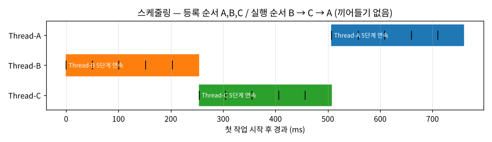

# [Analysis] 로그 타임스탬프 패턴으로 본 작업 스케줄링 기법 — 비선점 Priority (B > C > A)

> **[보너스 과제]** 미션 5번 "스케줄링 알고리즘 추론" 결과입니다.

| 항목 | 값 |
| --- | --- |
| 대상 | 정상 실행(`Healthy System Monitoring`) 시 `[Scheduler]` 가 처리하는 작업 `Thread-A` · `Thread-B` · `Thread-C` |
| 표본 | **정상 실행 8회** (전용 반복 실행 5회 + OOM·CPU·Deadlock After 실행 3회), 작업 로그 120줄 |
| 도구 | [`tools/analyze-schedule.sh`](../tools/analyze-schedule.sh) (grep + awk, ms 단위 타임라인·전환 횟수·연속성 계산) |
| 원본 | [`evidence/schedule-runs/analysis.txt`](../evidence/schedule-runs/analysis.txt) |
| 결론 | 선점 없음 + 등록 순서와 다른 고정 순서(B → C → A)가 8/8 반복 → **비선점 Priority** |

## 1. 로그 관찰 개요

정상 모드에서는 부팅 직후 앱 내부 스케줄러가 작업 3개를 등록하고 실행합니다. 각 줄의 **타임스탬프(ms)** · **작업 이름** · **진행률(%)** 로 "누가, 언제, 얼마나 오래, 중간에 끊겼는지" 를 패턴화했습니다.

```text
2026-10-12 22:44:42,596 [INFO] [Scheduler] Task Scheduler Initialized.
2026-10-12 22:44:42,597 [INFO] [Scheduler] Registered Tasks: ['Thread-A', 'Thread-B', 'Thread-C']   ← 등록(도착) 순서 A, B, C
2026-10-12 22:44:42,597 [INFO] [Scheduler] Starting task execution...
2026-10-12 22:44:42,597 [INFO] [Thread-B] Task Started. Calculating... (20%)                        ← 그런데 B 가 먼저
2026-10-12 22:44:42,647 [INFO] [Thread-B] Calculating... (40%)
2026-10-12 22:44:42,698 [INFO] [Thread-B] Calculating... (60%)
2026-10-12 22:44:42,749 [INFO] [Thread-B] Calculating... (80%)
2026-10-12 22:44:42,800 [INFO] [Thread-B] Task Completed. (100%)                                    ← B 가 끝날 때까지 아무도 끼어들지 않음
2026-10-12 22:44:42,850 [INFO] [Thread-C] Task Started. Calculating... (20%)
2026-10-12 22:44:43,054 [INFO] [Thread-C] Task Completed. (100%)
2026-10-12 22:44:43,104 [INFO] [Thread-A] Task Started. Calculating... (20%)                        ← 가장 먼저 등록된 A 가 마지막
2026-10-12 22:44:43,307 [INFO] [Thread-A] Task Completed. (100%)
2026-10-12 22:44:43,358 [INFO] [Scheduler] All tasks completed.
```

[`evidence/deadlock-after/20261012-224440/app.log`](../evidence/deadlock-after/20261012-224440/app.log)

## 2. 증거 자료

### 2-1. 타임라인 (`analyze-schedule.sh` 출력, 1회분)

```text
registered order : Thread-A,Thread-B,Thread-C
time           thread      pct  gap(ms)
22:48:30,403   Thread-B    20%        -
22:48:30,453   Thread-B    40%       50
22:48:30,504   Thread-B    60%       51
22:48:30,555   Thread-B    80%       51
22:48:30,606   Thread-B   100%       51
22:48:30,657   Thread-C    20%       51   <- switch
22:48:30,708   Thread-C    40%       51
22:48:30,758   Thread-C    60%       50
22:48:30,809   Thread-C    80%       51
22:48:30,860   Thread-C   100%       51
22:48:30,910   Thread-A    20%       50   <- switch
22:48:30,961   Thread-A    40%       51
22:48:31,012   Thread-A    60%       51
22:48:31,063   Thread-A    80%       51
22:48:31,113   Thread-A   100%       50

execution order  : Thread-B,Thread-C,Thread-A
context switches : 2 (threads 3 → 연속 실행이면 2)
each runs to 100% before next : yes (비선점)
  Thread-B: 22:48:30,403 ~ 22:48:30,606 (203 ms, 5 steps)
  Thread-C: 22:48:30,657 ~ 22:48:30,860 (203 ms, 5 steps)
  Thread-A: 22:48:30,910 ~ 22:48:31,113 (203 ms, 5 steps)
```



### 2-2. 8회 반복 요약

```text
SUMMARY (8 runs)
  run 1: order=Thread-B,Thread-C,Thread-A preemptive=no same_as_registered=no
  run 2: order=Thread-B,Thread-C,Thread-A preemptive=no same_as_registered=no
  …
  run 8: order=Thread-B,Thread-C,Thread-A preemptive=no same_as_registered=no
  distinct orders: 1 / preemptive runs: 0 / runs matching registration: 0
VERDICT: 비선점 + 등록 순서와 다른 고정 순서가 매번 반복 → Priority(비선점, 우선순위 순)
```

| 측정값 | 8회 결과 | 의미 |
| --- | --- | --- |
| 작업 전환 횟수 | **2회** (8/8) | 작업 3개가 각각 한 번씩만 CPU 를 받음. 끼어들기가 있었다면 3회 이상 |
| 각 작업의 연속 실행 | 20 → 40 → 60 → 80 → 100% 를 **끊김 없이** (8/8) | 완료 전에 다른 작업이 실행된 적 없음 = **비선점** |
| 작업당 실행 시간 | 203~204ms (5단계 × 약 50.7ms) | 세 작업의 길이가 같음 |
| 전환 간격 | 50~51ms (단계 간격과 동일) | 전환 비용·대기 없이 바로 다음 작업 |
| 실행 순서 | **B → C → A** (8/8, 다른 순서 0회) | 등록 순서(A, B, C)와 다르고, 매번 같음 |

## 3. 패턴 분석 및 결론

세 후보를 각각 "그 알고리즘이라면 로그가 어떻게 보여야 하는가" 와 비교했습니다.

| 후보 | 그 알고리즘이라면 기대되는 로그 | 실제 | 판정 |
| --- | --- | --- | --- |
| **Round-Robin** | 정해진 시간 할당량(quantum)마다 작업이 바뀜 → `A 20% → B 20% → C 20% → A 40% …` 처럼 **완료 전에 교대**, 전환 횟수 = 단계 수 가까이(최대 14회) | 전환 2회, 모든 작업이 100% 까지 연속 | **배제** |
| **FCFS** | 도착(등록) 순서대로 끝까지 → `A → B → C` | `B → C → A` (8/8) | **배제** |
| **Priority** | 우선순위 높은 순으로 실행. 우선순위가 고정이면 **매번 같은 순서**, 도착 순서와 무관 | 등록 순서와 다른 고정 순서가 8/8 반복 | **채택** |

**최종 결론: 비선점(Non-preemptive) Priority 스케줄링.** 우선순위는 `Thread-B > Thread-C > Thread-A` 로 추론됩니다.

**판단 근거의 논리 흐름**
1. 전환이 2회뿐이고 각 작업이 100% 까지 연속 실행 → **선점이 없다** → Round-Robin 이 아니다.
   (quantum 이 작업 길이 203ms 보다 큰 Round-Robin 은 FCFS 와 똑같이 보이는데, 그 경우도 도착 순서 A → B → C 여야 하므로 아래 2번에서 함께 배제된다.)
2. 비선점 알고리즘 중 FCFS 는 **도착 순서**를 따른다. 등록 로그의 순서 A, B, C 와 실행 순서 B, C, A 가 다르다 → FCFS 가 아니다.
3. 도착 순서가 아닌 **다른 기준**으로 고른다. 8번 실행해 모두 같은 순서 → 무작위가 아니라 **작업마다 고정된 값(우선순위)** 으로 정렬한 결과다.
4. 세 작업의 길이가 같으므로(203ms) "짧은 작업 우선(SJF)" 으로도 이 순서를 설명할 수 없다 → 길이 외의 고정 속성, 즉 우선순위.

**한계 (확인하지 못한 것)**
- 모든 작업이 같은 시각(22:44:42,597)에 한꺼번에 등록돼, 실행 도중 더 높은 우선순위 작업이 **새로 도착**하는 상황은 관찰되지 않았습니다. 따라서 "비선점" 은 **관찰된 범위에서** 의 결론이며, 선점형 Priority 와 이 로그만으로는 구분되지 않습니다(같은 시각에 모두 도착하면 둘의 실행 결과가 같음).
- `Registered Tasks` 출력 순서를 "도착 순서" 로 간주했습니다. 만약 등록 목록 순서와 실제 큐 삽입 순서가 다르다면 FCFS 일 가능성이 남지만, 그러려면 등록과 삽입 순서가 매번 B, C, A 로 고정돼야 해 Priority 보다 부자연스러운 설명입니다.
- `Thread-A/B/C` 는 앱이 붙인 **작업 이름**입니다. 커널 스케줄러(CFS)가 아니라 앱(런타임) 스케줄러의 동작을 본 것입니다. 2초 간격 관제로는 0.7초 동안의 OS 스레드 수 변화를 확정할 수 없어, 작업과 OS 스레드의 1:1 대응은 주장하지 않습니다.

## 4. 장단점 및 적합한 아키텍처

### 비선점 Priority 의 기술적 장단점

| 장점 | 단점 |
| --- | --- |
| 중요한 작업이 **항상 먼저** 끝난다 (응답 순서를 예측 가능) | **기아(Starvation):** 높은 우선순위 작업이 계속 들어오면 낮은 작업(A)은 영원히 실행되지 못할 수 있다 |
| 작업 중간 전환이 없어 **문맥 교환 비용이 최소** (이번 로그: 전환 2회, 전환 지연 ≈ 0) | **호위 효과(Convoy):** 비선점이라 긴 작업이 먼저 잡히면 뒤의 긴급 작업도 끝날 때까지 기다린다 |
| 작업 하나가 끝까지 실행돼 공유 데이터의 일관성 관리가 쉽다 (중간에 끊기지 않음) | **우선순위 역전:** 낮은 작업이 쥔 락을 높은 작업이 기다리면 중간 작업에게 밀린다 (상속·상한 프로토콜 필요) |
| 구현이 단순하다 (우선순위 큐 하나) | 우선순위를 누가·어떻게 정하는지가 운영 정책이 된다. 잘못 정하면 중요한 작업이 늦어진다 |

기아는 **에이징(aging)** — 오래 기다린 작업의 우선순위를 점점 올리는 방식 — 으로 완화합니다.

### 어떤 서비스에 적합한가

| 서비스 성격 | 적합도 | 이유 |
| --- | --- | --- |
| **배치·작업 큐 서버** (정산, 리포트 생성, 백업, 데이터 파이프라인) | **적합** | 처리량이 중요하고 작업 단위가 명확하다. "결제 정산 > 통계 집계 > 로그 압축" 처럼 업무 중요도로 순서를 정하기 좋고, 중간 전환이 없어 처리 효율이 높다 |
| **이벤트·알림 처리** (장애 알림 vs 마케팅 메일) | 적합 (에이징 필수) | 긴급 메시지를 먼저 처리해야 한다. 단, 낮은 우선순위가 굶지 않게 에이징·쿼터를 둔다 |
| **실시간 응답 웹 서버·API** | 부적합 | 요청마다 응답 시간이 고르게 짧아야 한다. 비선점이면 무거운 요청 하나가 뒤의 가벼운 요청 전부를 기다리게 한다 → **Round-Robin(시분할)** 이나 선점형이 유리 |
| **대화형 시스템** (터미널, GUI, 게임) | 부적합 | 사용자 입력에 즉시 반응해야 하므로 짧은 time slice 로 자주 전환하는 선점형이 필요 |

**이 앱에 대한 해석:** 부팅 직후 초기화 작업 3개를 정해진 중요도 순으로 한 번에 처리하는 용도라면 비선점 Priority 는 합리적입니다. 작업이 짧고(각 0.2초) 한 번만 실행되므로 기아·호위 효과가 문제되지 않습니다. 다만 같은 방식이 요청 처리 경로에 쓰인다면 응답 지연의 원인이 될 수 있어, 그때는 선점형(또는 RR) 전환과 에이징을 검토해야 합니다.

> 참고로 리눅스 커널의 기본 스케줄러(CFS)는 이와 달리 **선점형 + 공정 분배**(nice 가중치 기반)입니다. CPU 리포트에서 본 `nice=10` 은 CFS 에서 이 프로세스의 몫을 줄이는 설정입니다.

## 재현 방법

```bash
sudo -iu agent-admin
cd <repo>
for _ in 1 2 3 4 5; do tools/run-scenario.sh scenarios/cpu-after.env --max 8 --out evidence/schedule-runs; done
tools/analyze-schedule.sh evidence/schedule-runs/cpu-after/*/app.log
```
